# Graphics overhaul review: index

Every graphic the game draws, on review sheets with short IDs, so each one can be judged (`A03 good, A04 redo, C12.2 bad`). Generated by `build_sheets.py` (do not edit by hand; re-run it after a redraw). Draft material only: nothing here is approved art.

- Sheets: 20; asset rows (base IDs): 189; cells (variant IDs): 1156.
- Baked sprites in `src/renderer/src/art/pixel/sprites/`: 854, of which 854 appear on a sheet.
- Tags on cells: **IN GAME** shown in normal play; **GALLERY ONLY** only in the dev gallery (`#gallery`); **UNUSED** not reachable with current data; **CHECK WARN** pixel_check warning (table at the end).
- Captured art (live layers, effects, CSS, vector) comes from `tools/capture.mjs`, which renders the real renderer modules in headless Chromium with a fake clock; times on the cells are seconds after mounting.
- `art/vector/*.ts` are the source drawings the sprites are baked from (`bake.ts`); they are not drawn in the game, so they are not separate rows.

| Sheet | File | Covers | IDs |
| --- | --- | --- | --- |
| A | [sheet-A-card-items-1.png](sheet-A-card-items-1.png) | Card items I: swords, shield, staff, hatchet | A01-A06 (42 cells) |
| B | [sheet-B-card-items-2-evolutions.png](sheet-B-card-items-2-evolutions.png) | Card items II and unique evolutions | B01-B10 (64 cells) |
| C | [sheet-C-card-frames-chrome.png](sheet-C-card-frames-chrome.png) | Card frames and card chrome | C01-C07 (35 cells) |
| D | [sheet-D-coins-medals-icons.png](sheet-D-coins-medals-icons.png) | Gem coins, medals, Starlight, plaques and icons | D01-D14 (83 cells) |
| E | [sheet-E-tiles-forged-edges.png](sheet-E-tiles-forged-edges.png) | Production tiles and forged edges | E01-E09 (45 cells) |
| F | [sheet-F-bosses.png](sheet-F-bosses.png) | Bosses and the Crystal Sentinel | F01-F06 (27 cells) |
| G | [sheet-G-element-effects-gold.png](sheet-G-element-effects-gold.png) | Element effects at Gold (strength 1) | G01-G07 (35 cells) |
| H | [sheet-H-element-effects-prismatic.png](sheet-H-element-effects-prismatic.png) | Element effects at Prismatic (strength 2, stronger) | H01-H07 (35 cells) |
| I | [sheet-I-hits-attack-slashes-1.png](sheet-I-hits-attack-slashes-1.png) | Hit effects and attack slashes I | I01-I09 (39 cells) |
| J | [sheet-J-attack-slashes-2-numerals.png](sheet-J-attack-slashes-2-numerals.png) | Attack slashes II, tick and number styles | J01-J25 (100 cells) |
| K | [sheet-K-borders-garden.png](sheet-K-borders-garden.png) | Card borders I: garden sets | K01-K05 (25 cells) |
| L | [sheet-L-borders-moonwood.png](sheet-L-borders-moonwood.png) | Card borders II: Moonwood Dryad exclusives | L01-L05 (25 cells) |
| M | [sheet-M-finishes-garden.png](sheet-M-finishes-garden.png) | Card finishes I: garden sets | M01-M05 (25 cells) |
| N | [sheet-N-finishes-core-titan.png](sheet-N-finishes-core-titan.png) | Card finishes II: Core Titan exclusives | N01-N05 (30 cells) |
| O | [sheet-O-borders-loose-corners-pulses.png](sheet-O-borders-loose-corners-pulses.png) | Loose borders, corner flourishes, finish pulses | O01-O11 (30 cells) |
| P | [sheet-P-css-card-cosmetics.png](sheet-P-css-card-cosmetics.png) | Card cosmetics drawn in CSS (no sprite) | P01-P10 (34 cells) |
| Q | [sheet-Q-tables-cursors-particles.png](sheet-Q-tables-cursors-particles.png) | Tables, cursors, particles and decorations | Q01-Q14 (87 cells) |
| R | [sheet-R-stickers-achievements.png](sheet-R-stickers-achievements.png) | Achievement stickers | R01-R06 (88 cells) |
| S | [sheet-S-skill-nodes-charts.png](sheet-S-skill-nodes-charts.png) | Skill nodes and star charts | S01-S16 (215 cells) |
| T | [sheet-T-wardrobe-chrome.png](sheet-T-wardrobe-chrome.png) | Wardrobe chrome | T01-T12 (92 cells) |

## A: Card items I: swords, shield, staff, hatchet

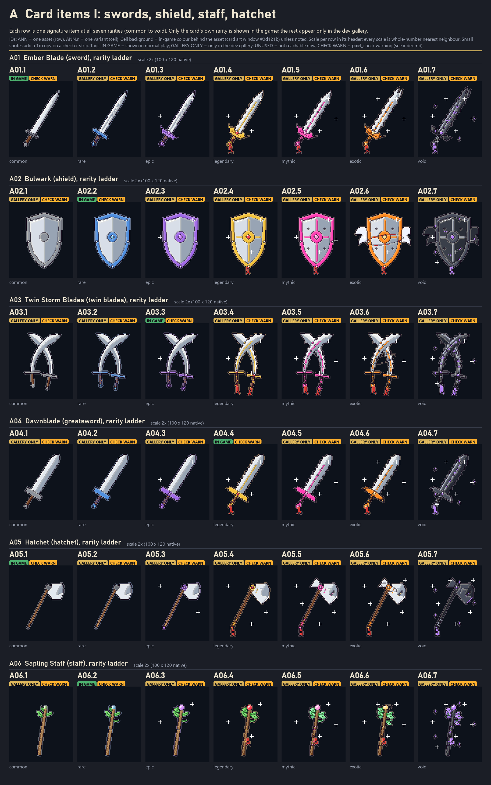

Each row is one signature item at all seven rarities (common to void). Only the card's own rarity is shown in the game; the rest appear only in the dev gallery.

| ID | Asset | Cells | Source | Used in game | Notes |
| --- | --- | --- | --- | --- | --- |
| A01 | Ember Blade (sword), rarity ladder | A01.1 common, A01.2 rare, A01.3 epic, A01.4 legendary, A01.5 mythic, A01.6 exotic, A01.7 void | `item-sword-<rarity>.png`; `itemArt()` in art/items.ts; drawn in art/vector/items.ts, baked by bake.ts | Card art window of Ember Squire (common); other rarities only in the dev gallery (#gallery) [gallery/game] | Approved 2026-11-07 (BETA_PLAN: card items, #43, treatment E+). Rarity adds parts (DESIGN 13). pixel_check warnings on 7 sprite(s). |
| A02 | Bulwark (shield), rarity ladder | A02.1 common, A02.2 rare, A02.3 epic, A02.4 legendary, A02.5 mythic, A02.6 exotic, A02.7 void | `item-shield-<rarity>.png`; `itemArt()` in art/items.ts; drawn in art/vector/items.ts, baked by bake.ts | Card art window of Shield Warden (rare); other rarities only in the dev gallery (#gallery) [gallery/game] | Approved 2026-11-07 (BETA_PLAN: card items, #43, treatment E+). Rarity adds parts (DESIGN 13). pixel_check warnings on 7 sprite(s). |
| A03 | Twin Storm Blades (twin blades), rarity ladder | A03.1 common, A03.2 rare, A03.3 epic, A03.4 legendary, A03.5 mythic, A03.6 exotic, A03.7 void | `item-twin_blades-<rarity>.png`; `itemArt()` in art/items.ts; drawn in art/vector/items.ts, baked by bake.ts | Card art window of Storm Duelist (epic); other rarities only in the dev gallery (#gallery) [gallery/game] | Approved 2026-11-07 (BETA_PLAN: card items, #43, treatment E+). Rarity adds parts (DESIGN 13). pixel_check warnings on 7 sprite(s). |
| A04 | Dawnblade (greatsword), rarity ladder | A04.1 common, A04.2 rare, A04.3 epic, A04.4 legendary, A04.5 mythic, A04.6 exotic, A04.7 void | `item-greatsword-<rarity>.png`; `itemArt()` in art/items.ts; drawn in art/vector/items.ts, baked by bake.ts | Card art window of Dawnblade Regent (legendary); other rarities only in the dev gallery (#gallery) [gallery/game] | Approved 2026-11-07 (BETA_PLAN: card items, #43, treatment E+). Rarity adds parts (DESIGN 13). pixel_check warnings on 7 sprite(s). |
| A05 | Hatchet (hatchet), rarity ladder | A05.1 common, A05.2 rare, A05.3 epic, A05.4 legendary, A05.5 mythic, A05.6 exotic, A05.7 void | `item-hatchet-<rarity>.png`; `itemArt()` in art/items.ts; drawn in art/vector/items.ts, baked by bake.ts | Card art window of Apprentice Feller (common); other rarities only in the dev gallery (#gallery) [gallery/game] | Approved 2026-11-07 (BETA_PLAN: card items, #43, treatment E+). Rarity adds parts (DESIGN 13). pixel_check warnings on 7 sprite(s). |
| A06 | Sapling Staff (staff), rarity ladder | A06.1 common, A06.2 rare, A06.3 epic, A06.4 legendary, A06.5 mythic, A06.6 exotic, A06.7 void | `item-staff-<rarity>.png`; `itemArt()` in art/items.ts; drawn in art/vector/items.ts, baked by bake.ts | Card art window of Grove Keeper (rare); other rarities only in the dev gallery (#gallery) [gallery/game] | Approved 2026-11-07 (BETA_PLAN: card items, #43, treatment E+). Rarity adds parts (DESIGN 13). pixel_check warnings on 7 sprite(s). |

## B: Card items II and unique evolutions

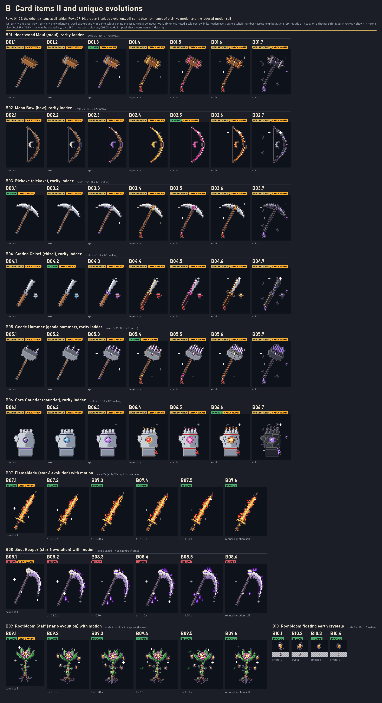

Rows 01-06: the other six items at all rarities. Rows 07-10: the star 6 unique evolutions, still sprite then key frames of their live motion and the reduced-motion still.

| ID | Asset | Cells | Source | Used in game | Notes |
| --- | --- | --- | --- | --- | --- |
| B01 | Heartwood Maul (maul), rarity ladder | B01.1 common, B01.2 rare, B01.3 epic, B01.4 legendary, B01.5 mythic, B01.6 exotic, B01.7 void | `item-maul-<rarity>.png`; `itemArt()` in art/items.ts; drawn in art/vector/items.ts, baked by bake.ts | Card art window of Elder Treant (epic); other rarities only in the dev gallery (#gallery) [gallery/game] | Approved 2026-11-07 (BETA_PLAN: card items, #43, treatment E+). Rarity adds parts (DESIGN 13). pixel_check warnings on 7 sprite(s). |
| B02 | Moon Bow (bow), rarity ladder | B02.1 common, B02.2 rare, B02.3 epic, B02.4 legendary, B02.5 mythic, B02.6 exotic, B02.7 void | `item-bow-<rarity>.png`; `itemArt()` in art/items.ts; drawn in art/vector/items.ts, baked by bake.ts | Card art window of Moonwood Dryad (mythic); other rarities only in the dev gallery (#gallery) [gallery/game] | Approved 2026-11-07 (BETA_PLAN: card items, #43, treatment E+). Rarity adds parts (DESIGN 13). pixel_check warnings on 7 sprite(s). |
| B03 | Pickaxe (pickaxe), rarity ladder | B03.1 common, B03.2 rare, B03.3 epic, B03.4 legendary, B03.5 mythic, B03.6 exotic, B03.7 void | `item-pickaxe-<rarity>.png`; `itemArt()` in art/items.ts; drawn in art/vector/items.ts, baked by bake.ts | Card art window of Cave Digger (common); other rarities only in the dev gallery (#gallery) [gallery/game] | Approved 2026-11-07 (BETA_PLAN: card items, #43, treatment E+). Rarity adds parts (DESIGN 13). pixel_check warnings on 7 sprite(s). |
| B04 | Cutting Chisel (chisel), rarity ladder | B04.1 common, B04.2 rare, B04.3 epic, B04.4 legendary, B04.5 mythic, B04.6 exotic, B04.7 void | `item-chisel-<rarity>.png`; `itemArt()` in art/items.ts; drawn in art/vector/items.ts, baked by bake.ts | Card art window of Gem Cutter (rare); other rarities only in the dev gallery (#gallery) [gallery/game] | Approved 2026-11-07 (BETA_PLAN: card items, #43, treatment E+). Rarity adds parts (DESIGN 13). pixel_check warnings on 7 sprite(s). |
| B05 | Geode Hammer (geode hammer), rarity ladder | B05.1 common, B05.2 rare, B05.3 epic, B05.4 legendary, B05.5 mythic, B05.6 exotic, B05.7 void | `item-geode_hammer-<rarity>.png`; `itemArt()` in art/items.ts; drawn in art/vector/items.ts, baked by bake.ts | Card art window of Geode Golem (legendary); other rarities only in the dev gallery (#gallery) [gallery/game] | Approved 2026-11-07 (BETA_PLAN: card items, #43, treatment E+). Rarity adds parts (DESIGN 13). pixel_check warnings on 7 sprite(s). |
| B06 | Core Gauntlet (gauntlet), rarity ladder | B06.1 common, B06.2 rare, B06.3 epic, B06.4 legendary, B06.5 mythic, B06.6 exotic, B06.7 void | `item-gauntlet-<rarity>.png`; `itemArt()` in art/items.ts; drawn in art/vector/items.ts, baked by bake.ts | Card art window of Core Titan (exotic); other rarities only in the dev gallery (#gallery) [gallery/game] | Approved 2026-11-07 (BETA_PLAN: card items, #43, treatment E+). Rarity adds parts (DESIGN 13). pixel_check warnings on 7 sprite(s). |
| B07 | Flameblade (star 6 evolution) with motion | B07.1 baked still, B07.2 t = 0.30 s, B07.3 t = 0.70 s, B07.4 t = 1.10 s, B07.5 t = 1.50 s, B07.6 reduced-motion still | `evo-flameblade.png`; live layer `evolutionArt()` in art/evolutions.ts | Card art window of a Gold+ star 6 card (loadoutCards.ts) [game] | Approved 2026-11-07 (BETA_PLAN: unique evolutions, #43). Motion frames captured live (12 fps loop). pixel_check warnings on 1 sprite(s). |
| B08 | Soul Reaper (star 6 evolution) with motion | B08.1 baked still, B08.2 t = 0.30 s, B08.3 t = 0.70 s, B08.4 t = 1.10 s, B08.5 t = 1.50 s, B08.6 reduced-motion still | `evo-soul_reaper.png`; live layer `evolutionArt()` in art/evolutions.ts | Not reachable: no Void fighting card in the beta (DESIGN 16 E6) [unused] | Approved 2026-11-07 (BETA_PLAN: unique evolutions, #43). Motion frames captured live (12 fps loop). pixel_check warnings on 1 sprite(s). |
| B09 | Rootbloom Staff (star 6 evolution) with motion | B09.1 baked still, B09.2 t = 0.30 s, B09.3 t = 0.70 s, B09.4 t = 1.10 s, B09.5 t = 1.50 s, B09.6 reduced-motion still | `evo-rootbloom_staff.png`; live layer `evolutionArt()` in art/evolutions.ts | Card art window of a Gold+ star 6 card (loadoutCards.ts) [game] | Approved 2026-11-07 (BETA_PLAN: unique evolutions, #43). Motion frames captured live (12 fps loop). pixel_check warnings on 1 sprite(s). |
| B10 | Rootbloom floating earth crystals | B10.1 crystal 0, B10.2 crystal 1, B10.3 crystal 2, B10.4 crystal 3 | `evo-rootbloom_staff-crystal0..3.png`; used by the Rootbloom live layer | Orbit the Rootbloom Staff [game] | Part of the approved Rootbloom Staff. pixel_check warnings on 4 sprite(s). |

## C: Card frames and card chrome

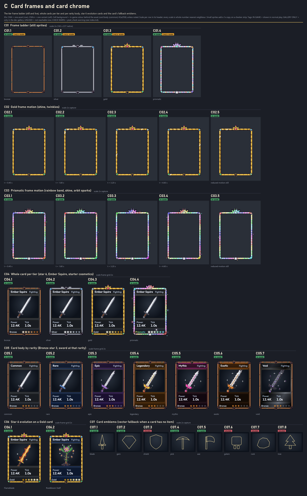

The tier frame ladder (still and live), whole cards per tier and per rarity body, star 6 evolution cards and the card's fallback emblems.

| ID | Asset | Cells | Source | Used in game | Notes |
| --- | --- | --- | --- | --- | --- |
| C01 | Frame ladder (still sprites) | C01.1 bronze, C01.2 silver, C01.3 gold, C01.4 prismatic | `frame-<tier>.png`; `cardFrame()` in art/frame.ts; drawn in art/vector/frame.ts | Every card (ui/card.ts) [game] | Approved 2026-11-07 (frame ladder, #43). In game the card is 176 x 248 css for a 132 x 186 grid, so frame pixels show at 1.33 css px (not a whole-number scale). pixel_check warnings on 4 sprite(s). |
| C02 | Gold frame motion (shine, twinkles) | C02.1 t = 0.40 s, C02.2 t = 1.80 s, C02.3 t = 3.20 s, C02.4 t = 4.60 s, C02.5 reduced-motion still | live layer `frame-gold` in art/frame.ts over `frame-gold.png` | Every Gold / Prismatic card [game] | Approved with the frame ladder. Captured live; the shine sweep takes about 12 s per pass, so most frames show it partly. |
| C03 | Prismatic frame motion (rainbow band, shine, orbit sparks) | C03.1 t = 0.40 s, C03.2 t = 1.80 s, C03.3 t = 3.20 s, C03.4 t = 4.60 s, C03.5 reduced-motion still | live layer `frame-prismatic` in art/frame.ts over `frame-prismatic.png` | Every Gold / Prismatic card [game] | Approved with the frame ladder. Captured live; the shine sweep takes about 12 s per pass, so most frames show it partly. |
| C04 | Whole card per tier (star 6, Ember Squire, starter cosmetics) | C04.1 bronze, C04.2 silver, C04.3 gold, C04.4 prismatic | ui/card.ts (`createCard`) + theme/base.css, rank.css (ui-owned chrome) + art frame and item | Cards page, loadout, summon, wardrobe [game] | Composite screenshot; the frame grid is shown at 2x (captured at device scale 1.5). Stars are text glyphs (CSS). |
| C05 | Card body by rarity (Bronze star 3, sword at that rarity) | C05.1 common, C05.2 rare, C05.3 epic, C05.4 legendary, C05.5 mythic, C05.6 exotic, C05.7 void | rarity body colour tokens (rarities.json, theme/apply.ts), `neon` (mythic, exotic) and `chrome` (void) recipes in recipes.css | Every card [game] | CSS, not pixel art: gradients and colour washes. |
| C06 | Star 6 evolution on a Gold card | C06.1 Flameblade, C06.2 Rootbloom Staff | loadoutCards.ts + `evolutionArt()` | Loadout cards at Gold star 6 [game] | Composite screenshot. |
| C07 | Card emblems (vector fallback when a card has no item) | C07.1 blade, C07.2 gem, C07.3 shield, C07.4 pick, C07.5 axe, C07.6 golem, C07.7 rock, C07.8 tree | `EMBLEMS` in ui/card.ts (ui-owned, vector) | Only when a card has no item art; every beta card has an item, so in practice hidden. blade / gem / axe / pick are still passed by pages [game/unused] | Legacy vector placeholders (comment: 'until real card art exists'). |

## D: Gem coins, medals, Starlight, plaques and icons

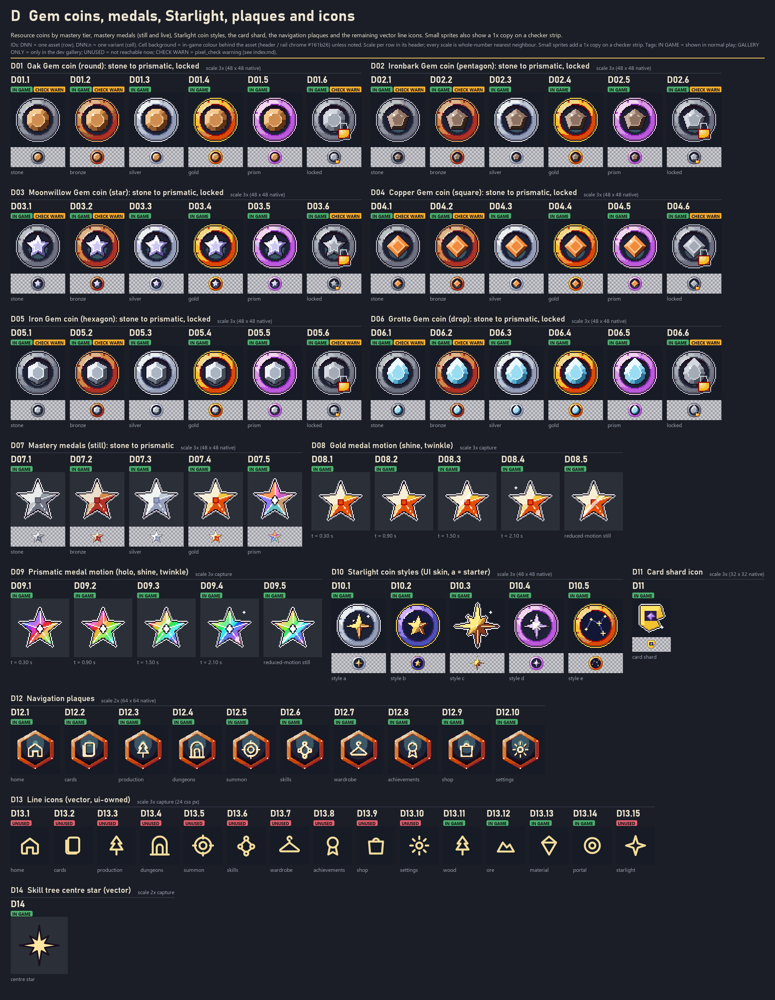

Resource coins by mastery tier, mastery medals (still and live), Starlight coin styles, the card shard, the navigation plaques and the remaining vector line icons. Small sprites also show a 1x copy on a checker strip.

| ID | Asset | Cells | Source | Used in game | Notes |
| --- | --- | --- | --- | --- | --- |
| D01 | Oak Gem coin (round): stone to prismatic, locked | D01.1 stone, D01.2 bronze, D01.3 silver, D01.4 gold, D01.5 prism, D01.6 locked | `coin-round-<metal\|locked>.png`; `gemCoin()` in art/gems.ts | Header counters, achievements, Ascension, drops (coin metal = gem mastery tier) [game] | Approved 2026-11-07 (gem coins, #45). pixel_check warnings on 3 sprite(s). |
| D02 | Ironbark Gem coin (pentagon): stone to prismatic, locked | D02.1 stone, D02.2 bronze, D02.3 silver, D02.4 gold, D02.5 prism, D02.6 locked | `coin-pentagon-<metal\|locked>.png`; `gemCoin()` in art/gems.ts | Header counters, achievements, Ascension, drops (coin metal = gem mastery tier) [game] | Approved 2026-11-07 (gem coins, #45). pixel_check warnings on 3 sprite(s). |
| D03 | Moonwillow Gem coin (star): stone to prismatic, locked | D03.1 stone, D03.2 bronze, D03.3 silver, D03.4 gold, D03.5 prism, D03.6 locked | `coin-star-<metal\|locked>.png`; `gemCoin()` in art/gems.ts | Header counters, achievements, Ascension, drops (coin metal = gem mastery tier) [game] | Approved 2026-11-07 (gem coins, #45). pixel_check warnings on 3 sprite(s). |
| D04 | Copper Gem coin (square): stone to prismatic, locked | D04.1 stone, D04.2 bronze, D04.3 silver, D04.4 gold, D04.5 prism, D04.6 locked | `coin-square-<metal\|locked>.png`; `gemCoin()` in art/gems.ts | Header counters, achievements, Ascension, drops (coin metal = gem mastery tier) [game] | Approved 2026-11-07 (gem coins, #45). pixel_check warnings on 3 sprite(s). |
| D05 | Iron Gem coin (hexagon): stone to prismatic, locked | D05.1 stone, D05.2 bronze, D05.3 silver, D05.4 gold, D05.5 prism, D05.6 locked | `coin-hexagon-<metal\|locked>.png`; `gemCoin()` in art/gems.ts | Header counters, achievements, Ascension, drops (coin metal = gem mastery tier) [game] | Approved 2026-11-07 (gem coins, #45). pixel_check warnings on 3 sprite(s). |
| D06 | Grotto Gem coin (drop): stone to prismatic, locked | D06.1 stone, D06.2 bronze, D06.3 silver, D06.4 gold, D06.5 prism, D06.6 locked | `coin-drop-<metal\|locked>.png`; `gemCoin()` in art/gems.ts | Header counters, achievements, Ascension, drops (coin metal = gem mastery tier) [game] | Approved 2026-11-07 (gem coins, #45). pixel_check warnings on 3 sprite(s). |
| D07 | Mastery medals (still): stone to prismatic | D07.1 stone, D07.2 bronze, D07.3 silver, D07.4 gold, D07.5 prism | `medal-0..4.png`; `masteryMedal()` in art/gems.ts | Floor rail, arena next to the boss, Ascension [game] | Approved 2026-11-07 (mastery medals, #45). |
| D08 | Gold medal motion (shine, twinkle) | D08.1 t = 0.30 s, D08.2 t = 0.90 s, D08.3 t = 1.50 s, D08.4 t = 2.10 s, D08.5 reduced-motion still | live layer `medal-3` in art/gems.ts | Wherever a Gold / Prismatic medal shows [game] | Captured live. |
| D09 | Prismatic medal motion (holo, shine, twinkle) | D09.1 t = 0.30 s, D09.2 t = 0.90 s, D09.3 t = 1.50 s, D09.4 t = 2.10 s, D09.5 reduced-motion still | live layer `medal-4` in art/gems.ts | Wherever a Gold / Prismatic medal shows [game] | Captured live. |
| D10 | Starlight coin styles (UI skin, a = starter) | D10.1 style a, D10.2 style b, D10.3 style c, D10.4 style d, D10.5 style e | `cos-starlight-<a..e>.png`; `starlightCoin()` in art/cosmetics.ts; drawn by scripts/art/cosmetics/*.py | Header chip, Ascension gate, shops (equipped style) [game] | Beta batch B1, every option kept as a cosmetic (BETA_PLAN 'Decided visuals'). |
| D11 | Card shard icon | card shard | `cos-card-shard.png`; `cardShardIcon()` | Achievements shard shop [game] | Beta batch B6. |
| D12 | Navigation plaques | D12.1 home, D12.2 cards, D12.3 production, D12.4 dungeons, D12.5 summon, D12.6 skills, D12.7 wardrobe, D12.8 achievements, D12.9 shop, D12.10 settings | `plaque-<page>.png`; `navPlaque()` in art/gems.ts | Left rail (shell.ts) [game] | Approved 2026-11-07 (navigation plaques, #45). In game drawn at 32 css px, i.e. half of the 64 px grid (downscaled, not a whole-number scale). |
| D13 | Line icons (vector, ui-owned) | D13.1 home, D13.2 cards, D13.3 production, D13.4 dungeons, D13.5 summon, D13.6 skills, D13.7 wardrobe, D13.8 achievements, D13.9 shop, D13.10 settings, D13.11 wood, D13.12 ore, D13.13 material, D13.14 portal, D13.15 starlight | shell/icons.ts (`icon()`), stroked with currentColor (captured in the starter gold) | material / portal / wood / ore: currency chips, reward track, achievement offers. Page icons: the rail now shows plaques; starlight: header uses the pixel coin [game/unused] | Vector line art, not pixel. Page icons are still listed in PAGES but not drawn (rail uses plaques). |
| D14 | Skill tree centre star (vector) | centre star | `centreStar()` in ui/skillArt.ts | Skills page constellation centre [game] | The only part of the skill tree still in vector (comment in skillArt.ts). |

## E: Production tiles and forged edges

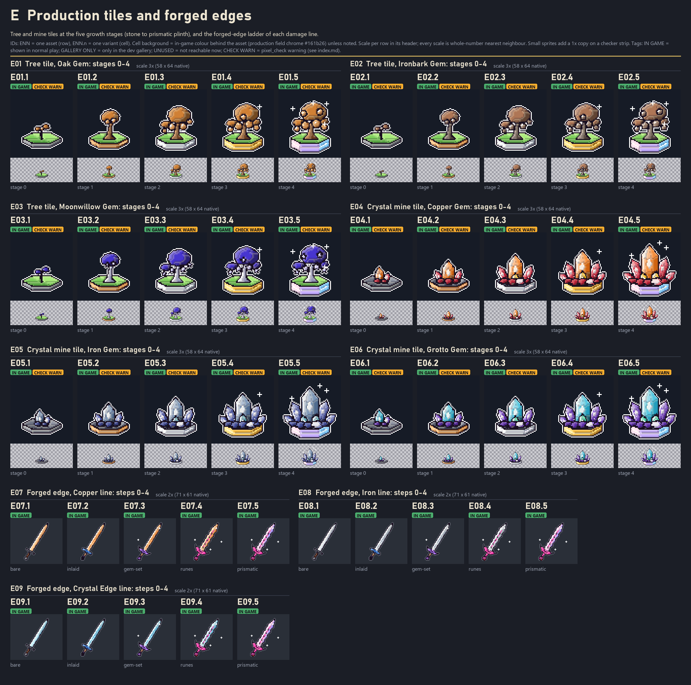

Tree and mine tiles at the five growth stages (stone to prismatic plinth), and the forged-edge ladder of each damage line.

| ID | Asset | Cells | Source | Used in game | Notes |
| --- | --- | --- | --- | --- | --- |
| E01 | Tree tile, Oak Gem: stages 0-4 | E01.1 stage 0, E01.2 stage 1, E01.3 stage 2, E01.4 stage 3, E01.5 stage 4 | `tile-tree-round-0..4.png`; `treeTile()` in art/gems.ts; drawn in art/vector/tiles.ts | Production fields, Home mini-stages [game] | Approved 2026-11-07 (tiles, #45). Brave Frontier pass planned after the beta (BETA_PLAN). pixel_check warnings on 5 sprite(s). |
| E02 | Tree tile, Ironbark Gem: stages 0-4 | E02.1 stage 0, E02.2 stage 1, E02.3 stage 2, E02.4 stage 3, E02.5 stage 4 | `tile-tree-pentagon-0..4.png`; `treeTile()` in art/gems.ts; drawn in art/vector/tiles.ts | Production fields, Home mini-stages [game] | Approved 2026-11-07 (tiles, #45). Brave Frontier pass planned after the beta (BETA_PLAN). pixel_check warnings on 5 sprite(s). |
| E03 | Tree tile, Moonwillow Gem: stages 0-4 | E03.1 stage 0, E03.2 stage 1, E03.3 stage 2, E03.4 stage 3, E03.5 stage 4 | `tile-tree-star-0..4.png`; `treeTile()` in art/gems.ts; drawn in art/vector/tiles.ts | Production fields, Home mini-stages [game] | Approved 2026-11-07 (tiles, #45). Brave Frontier pass planned after the beta (BETA_PLAN). pixel_check warnings on 5 sprite(s). |
| E04 | Crystal mine tile, Copper Gem: stages 0-4 | E04.1 stage 0, E04.2 stage 1, E04.3 stage 2, E04.4 stage 3, E04.5 stage 4 | `tile-mine-square-0..4.png`; `mineTile()` in art/gems.ts; drawn in art/vector/tiles.ts | Production fields, Home mini-stages [game] | Approved 2026-11-07 (tiles, #45). Brave Frontier pass planned after the beta (BETA_PLAN). pixel_check warnings on 5 sprite(s). |
| E05 | Crystal mine tile, Iron Gem: stages 0-4 | E05.1 stage 0, E05.2 stage 1, E05.3 stage 2, E05.4 stage 3, E05.5 stage 4 | `tile-mine-hexagon-0..4.png`; `mineTile()` in art/gems.ts; drawn in art/vector/tiles.ts | Production fields, Home mini-stages [game] | Approved 2026-11-07 (tiles, #45). Brave Frontier pass planned after the beta (BETA_PLAN). pixel_check warnings on 5 sprite(s). |
| E06 | Crystal mine tile, Grotto Gem: stages 0-4 | E06.1 stage 0, E06.2 stage 1, E06.3 stage 2, E06.4 stage 3, E06.5 stage 4 | `tile-mine-drop-0..4.png`; `mineTile()` in art/gems.ts; drawn in art/vector/tiles.ts | Production fields, Home mini-stages [game] | Approved 2026-11-07 (tiles, #45). Brave Frontier pass planned after the beta (BETA_PLAN). pixel_check warnings on 5 sprite(s). |
| E07 | Forged edge, Copper line: steps 0-4 | E07.1 bare, E07.2 inlaid, E07.3 gem-set, E07.4 runes, E07.5 prismatic | `edge-square-0..4.png`; `forgedEdge()` in art/gems.ts | Arena drawer ladder strip, Ascension [game] | Approved 2026-11-07 (forged edges, #45). pixel_check warnings on 5 sprite(s). |
| E08 | Forged edge, Iron line: steps 0-4 | E08.1 bare, E08.2 inlaid, E08.3 gem-set, E08.4 runes, E08.5 prismatic | `edge-hexagon-0..4.png`; `forgedEdge()` in art/gems.ts | Arena drawer ladder strip, Ascension [game] | Approved 2026-11-07 (forged edges, #45). pixel_check warnings on 5 sprite(s). |
| E09 | Forged edge, Crystal Edge line: steps 0-4 | E09.1 bare, E09.2 inlaid, E09.3 gem-set, E09.4 runes, E09.5 prismatic | `edge-drop-0..4.png`; `forgedEdge()` in art/gems.ts | Arena drawer ladder strip, Ascension [game] | Approved 2026-11-07 (forged edges, #45). pixel_check warnings on 5 sprite(s). |

## F: Bosses and the Crystal Sentinel

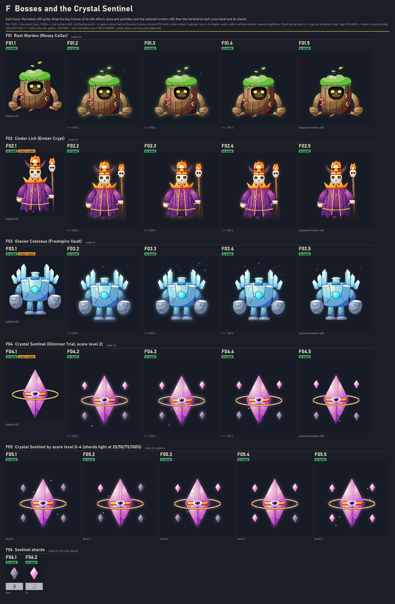

Each boss: the baked still sprite, three live key frames of its idle effects (aura and particles) and the reduced-motion still; then the Sentinel at each score level and its shards.

| ID | Asset | Cells | Source | Used in game | Notes |
| --- | --- | --- | --- | --- | --- |
| F01 | Root Warden (Mossy Cellar) | F01.1 baked still, F01.2 t = 0.40 s, F01.3 t = 0.90 s, F01.4 t = 1.40 s, F01.5 reduced-motion still | `boss-root_warden.png`; `bossArt()` live layer in art/bosses.ts; drawn in art/vector/bosses.ts | Dungeons arena, floor portrait, Home fight stage [game] | Approved 2026-11-07 (bosses, #48). Post-beta: smoother tone shapes on large areas (Lich robe shows tone rings). |
| F02 | Cinder Lich (Ember Crypt) | F02.1 baked still, F02.2 t = 0.40 s, F02.3 t = 0.90 s, F02.4 t = 1.40 s, F02.5 reduced-motion still | `boss-cinder_lich.png`; `bossArt()` live layer in art/bosses.ts; drawn in art/vector/bosses.ts | Dungeons arena, floor portrait, Home fight stage [game] | Approved 2026-11-07 (bosses, #48). Post-beta: smoother tone shapes on large areas (Lich robe shows tone rings). pixel_check warnings on 1 sprite(s). |
| F03 | Glacier Colossus (Frostspire Vault) | F03.1 baked still, F03.2 t = 0.40 s, F03.3 t = 0.90 s, F03.4 t = 1.40 s, F03.5 reduced-motion still | `boss-glacier_colossus.png`; `bossArt()` live layer in art/bosses.ts; drawn in art/vector/bosses.ts | Dungeons arena, floor portrait, Home fight stage [game] | Approved 2026-11-07 (bosses, #48). Post-beta: smoother tone shapes on large areas (Lich robe shows tone rings). pixel_check warnings on 1 sprite(s). |
| F04 | Crystal Sentinel (Glimmer Trial, score level 2) | F04.1 baked still, F04.2 t = 0.40 s, F04.3 t = 0.90 s, F04.4 t = 1.40 s, F04.5 reduced-motion still | `boss-crystal_sentinel.png`; `bossArt()` live layer in art/bosses.ts; drawn in art/vector/bosses.ts | Dungeons arena, floor portrait, Home fight stage [game] | Approved 2026-11-07 (bosses, #48). Post-beta: smoother tone shapes on large areas (Lich robe shows tone rings). pixel_check warnings on 1 sprite(s). |
| F05 | Crystal Sentinel by score level 0-4 (shards light at 25/50/75/100%) | F05.1 level 0, F05.2 level 1, F05.3 level 2, F05.4 level 3, F05.5 level 4 | `bossArt('crystal_sentinel', level)` | Glimmer Trial [game] | Captured at t = 1 s. |
| F06 | Sentinel shards | F06.1 dim, F06.2 lit | `boss-shard-dim/lit.png` | Orbit the Sentinel [game] |  |

## G: Element effects at Gold (strength 1)

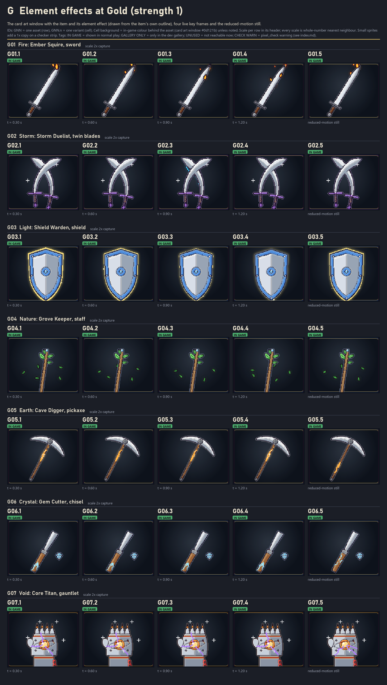

The card art window with the item and its element effect (drawn from the item's own outline), four live key frames and the reduced-motion still.

| ID | Asset | Cells | Source | Used in game | Notes |
| --- | --- | --- | --- | --- | --- |
| G01 | Fire: Ember Squire, sword | G01.1 t = 0.30 s, G01.2 t = 0.60 s, G01.3 t = 0.90 s, G01.4 t = 1.20 s, G01.5 reduced-motion still | art/fx.ts (`attachElementFx`), fxGeometry.ts; canvases behind and in front of the item | Every fire card at Gold and above [game] | Approved 2026-11-07 (effects, #48, P5 C). Uses Math.random (not seeded); the capture seeds it for stable frames. |
| G02 | Storm: Storm Duelist, twin blades | G02.1 t = 0.30 s, G02.2 t = 0.60 s, G02.3 t = 0.90 s, G02.4 t = 1.20 s, G02.5 reduced-motion still | art/fx.ts (`attachElementFx`), fxGeometry.ts; canvases behind and in front of the item | Every storm card at Gold and above [game] | Approved 2026-11-07 (effects, #48, P5 C). Uses Math.random (not seeded); the capture seeds it for stable frames. |
| G03 | Light: Shield Warden, shield | G03.1 t = 0.30 s, G03.2 t = 0.60 s, G03.3 t = 0.90 s, G03.4 t = 1.20 s, G03.5 reduced-motion still | art/fx.ts (`attachElementFx`), fxGeometry.ts; canvases behind and in front of the item | Every light card at Gold and above [game] | Approved 2026-11-07 (effects, #48, P5 C). Uses Math.random (not seeded); the capture seeds it for stable frames. |
| G04 | Nature: Grove Keeper, staff | G04.1 t = 0.30 s, G04.2 t = 0.60 s, G04.3 t = 0.90 s, G04.4 t = 1.20 s, G04.5 reduced-motion still | art/fx.ts (`attachElementFx`), fxGeometry.ts; canvases behind and in front of the item | Every nature card at Gold and above [game] | Approved 2026-11-07 (effects, #48, P5 C). Uses Math.random (not seeded); the capture seeds it for stable frames. |
| G05 | Earth: Cave Digger, pickaxe | G05.1 t = 0.30 s, G05.2 t = 0.60 s, G05.3 t = 0.90 s, G05.4 t = 1.20 s, G05.5 reduced-motion still | art/fx.ts (`attachElementFx`), fxGeometry.ts; canvases behind and in front of the item | Every earth card at Gold and above [game] | Approved 2026-11-07 (effects, #48, P5 C). Uses Math.random (not seeded); the capture seeds it for stable frames. |
| G06 | Crystal: Gem Cutter, chisel | G06.1 t = 0.30 s, G06.2 t = 0.60 s, G06.3 t = 0.90 s, G06.4 t = 1.20 s, G06.5 reduced-motion still | art/fx.ts (`attachElementFx`), fxGeometry.ts; canvases behind and in front of the item | Every crystal card at Gold and above [game] | Approved 2026-11-07 (effects, #48, P5 C). Uses Math.random (not seeded); the capture seeds it for stable frames. |
| G07 | Void: Core Titan, gauntlet | G07.1 t = 0.30 s, G07.2 t = 0.60 s, G07.3 t = 0.90 s, G07.4 t = 1.20 s, G07.5 reduced-motion still | art/fx.ts (`attachElementFx`), fxGeometry.ts; canvases behind and in front of the item | Every void card at Gold and above [game] | Approved 2026-11-07 (effects, #48, P5 C). Uses Math.random (not seeded); the capture seeds it for stable frames. |

## H: Element effects at Prismatic (strength 2, stronger)

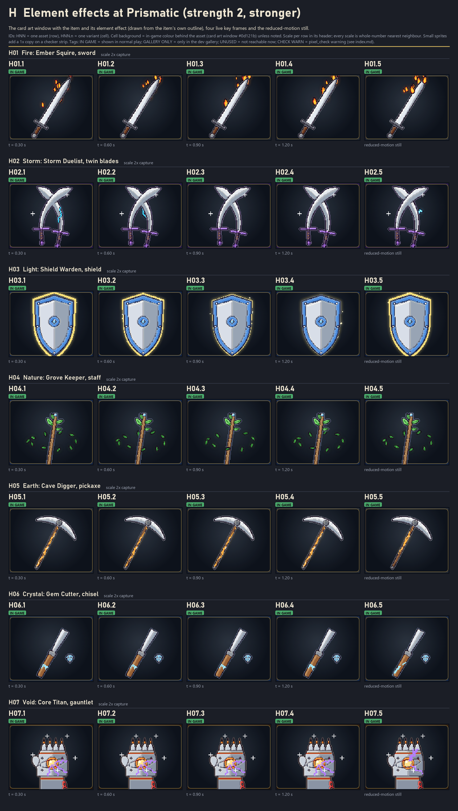

The card art window with the item and its element effect (drawn from the item's own outline), four live key frames and the reduced-motion still.

| ID | Asset | Cells | Source | Used in game | Notes |
| --- | --- | --- | --- | --- | --- |
| H01 | Fire: Ember Squire, sword | H01.1 t = 0.30 s, H01.2 t = 0.60 s, H01.3 t = 0.90 s, H01.4 t = 1.20 s, H01.5 reduced-motion still | art/fx.ts (`attachElementFx`), fxGeometry.ts; canvases behind and in front of the item | Every fire card at Prismatic and above [game] | Approved 2026-11-07 (effects, #48, P5 C). Uses Math.random (not seeded); the capture seeds it for stable frames. |
| H02 | Storm: Storm Duelist, twin blades | H02.1 t = 0.30 s, H02.2 t = 0.60 s, H02.3 t = 0.90 s, H02.4 t = 1.20 s, H02.5 reduced-motion still | art/fx.ts (`attachElementFx`), fxGeometry.ts; canvases behind and in front of the item | Every storm card at Prismatic and above [game] | Approved 2026-11-07 (effects, #48, P5 C). Uses Math.random (not seeded); the capture seeds it for stable frames. |
| H03 | Light: Shield Warden, shield | H03.1 t = 0.30 s, H03.2 t = 0.60 s, H03.3 t = 0.90 s, H03.4 t = 1.20 s, H03.5 reduced-motion still | art/fx.ts (`attachElementFx`), fxGeometry.ts; canvases behind and in front of the item | Every light card at Prismatic and above [game] | Approved 2026-11-07 (effects, #48, P5 C). Uses Math.random (not seeded); the capture seeds it for stable frames. |
| H04 | Nature: Grove Keeper, staff | H04.1 t = 0.30 s, H04.2 t = 0.60 s, H04.3 t = 0.90 s, H04.4 t = 1.20 s, H04.5 reduced-motion still | art/fx.ts (`attachElementFx`), fxGeometry.ts; canvases behind and in front of the item | Every nature card at Prismatic and above [game] | Approved 2026-11-07 (effects, #48, P5 C). Uses Math.random (not seeded); the capture seeds it for stable frames. |
| H05 | Earth: Cave Digger, pickaxe | H05.1 t = 0.30 s, H05.2 t = 0.60 s, H05.3 t = 0.90 s, H05.4 t = 1.20 s, H05.5 reduced-motion still | art/fx.ts (`attachElementFx`), fxGeometry.ts; canvases behind and in front of the item | Every earth card at Prismatic and above [game] | Approved 2026-11-07 (effects, #48, P5 C). Uses Math.random (not seeded); the capture seeds it for stable frames. |
| H06 | Crystal: Gem Cutter, chisel | H06.1 t = 0.30 s, H06.2 t = 0.60 s, H06.3 t = 0.90 s, H06.4 t = 1.20 s, H06.5 reduced-motion still | art/fx.ts (`attachElementFx`), fxGeometry.ts; canvases behind and in front of the item | Every crystal card at Prismatic and above [game] | Approved 2026-11-07 (effects, #48, P5 C). Uses Math.random (not seeded); the capture seeds it for stable frames. |
| H07 | Void: Core Titan, gauntlet | H07.1 t = 0.30 s, H07.2 t = 0.60 s, H07.3 t = 0.90 s, H07.4 t = 1.20 s, H07.5 reduced-motion still | art/fx.ts (`attachElementFx`), fxGeometry.ts; canvases behind and in front of the item | Every void card at Prismatic and above [game] | Approved 2026-11-07 (effects, #48, P5 C). Uses Math.random (not seeded); the capture seeds it for stable frames. |

## I: Hit effects and attack slashes I

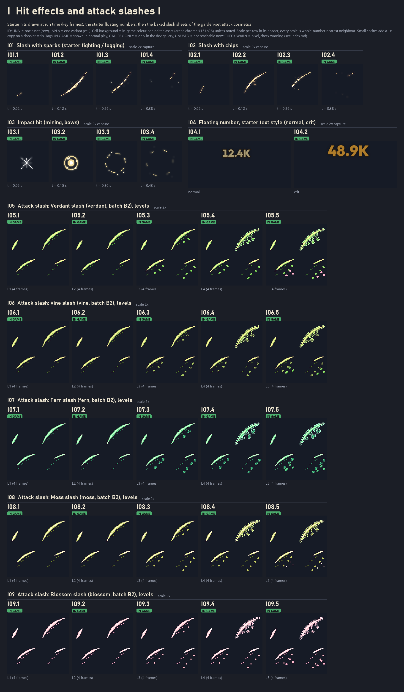

Starter hits drawn at run time (key frames), the starter floating numbers, then the baked slash sheets of the garden-set attack cosmetics.

| ID | Asset | Cells | Source | Used in game | Notes |
| --- | --- | --- | --- | --- | --- |
| I01 | Slash with sparks (starter fighting / logging) | I01.1 t = 0.02 s, I01.2 t = 0.12 s, I01.3 t = 0.26 s, I01.4 t = 0.38 s | `slash()` / `impact()` in theme/effects.ts (canvas, 2 css px per pixel, blurred glow copy) | Arena and production stages (starter attack cosmetic) [game] | Approved 2026-11-07 (hits, #48: thin slash). thin brush slash, re-rolled every hit. |
| I02 | Slash with chips | I02.1 t = 0.02 s, I02.2 t = 0.12 s, I02.3 t = 0.26 s, I02.4 t = 0.38 s | `slash()` / `impact()` in theme/effects.ts (canvas, 2 css px per pixel, blurred glow copy) | Arena and production stages (starter attack cosmetic) [game] | Approved 2026-11-07 (hits, #48: thin slash). same slash, square wood chips. |
| I03 | Impact hit (mining, bows) | I03.1 t = 0.05 s, I03.2 t = 0.15 s, I03.3 t = 0.30 s, I03.4 t = 0.43 s | `slash()` / `impact()` in theme/effects.ts (canvas, 2 css px per pixel, blurred glow copy) | Arena and production stages (starter attack cosmetic) [game] | Approved 2026-11-07 (hits, #48: thin slash). star flash, ring, chips. |
| I04 | Floating number, starter text style (normal, crit) | I04.1 normal, I04.2 crit | `showTick()` in theme/effects.ts + effects.css / stage/numbers.css (text, CSS) | Every hit and tick without a pixel tick style [game] | Text in CSS, not pixel art; frozen mid-rise. |
| I05 | Attack slash: Verdant slash (verdant, batch B2), levels | I05.1 L1 (4 frames), I05.2 L2 (4 frames), I05.3 L3 (4 frames), I05.4 L4 (4 frames), I05.5 L5 (4 frames) | `cos-atk-verdant-<level>.png` (4 frames of 64 px: snap, held hit, thin, break); played by `pixelSlash()` in theme/effects.ts | Arena and production hits when the attack cosmetic is equipped [game] | Each level cell shows the 4 frames as a 2 x 2 grid (read left to right, top to bottom); timing 50/130/90/110 ms. |
| I06 | Attack slash: Vine slash (vine, batch B2), levels | I06.1 L1 (4 frames), I06.2 L2 (4 frames), I06.3 L3 (4 frames), I06.4 L4 (4 frames), I06.5 L5 (4 frames) | `cos-atk-vine-<level>.png` (4 frames of 64 px: snap, held hit, thin, break); played by `pixelSlash()` in theme/effects.ts | Arena and production hits when the attack cosmetic is equipped [game] | Each level cell shows the 4 frames as a 2 x 2 grid (read left to right, top to bottom); timing 50/130/90/110 ms. |
| I07 | Attack slash: Fern slash (fern, batch B2), levels | I07.1 L1 (4 frames), I07.2 L2 (4 frames), I07.3 L3 (4 frames), I07.4 L4 (4 frames), I07.5 L5 (4 frames) | `cos-atk-fern-<level>.png` (4 frames of 64 px: snap, held hit, thin, break); played by `pixelSlash()` in theme/effects.ts | Arena and production hits when the attack cosmetic is equipped [game] | Each level cell shows the 4 frames as a 2 x 2 grid (read left to right, top to bottom); timing 50/130/90/110 ms. |
| I08 | Attack slash: Moss slash (moss, batch B2), levels | I08.1 L1 (4 frames), I08.2 L2 (4 frames), I08.3 L3 (4 frames), I08.4 L4 (4 frames), I08.5 L5 (4 frames) | `cos-atk-moss-<level>.png` (4 frames of 64 px: snap, held hit, thin, break); played by `pixelSlash()` in theme/effects.ts | Arena and production hits when the attack cosmetic is equipped [game] | Each level cell shows the 4 frames as a 2 x 2 grid (read left to right, top to bottom); timing 50/130/90/110 ms. |
| I09 | Attack slash: Blossom slash (blossom, batch B2), levels | I09.1 L1 (4 frames), I09.2 L2 (4 frames), I09.3 L3 (4 frames), I09.4 L4 (4 frames), I09.5 L5 (4 frames) | `cos-atk-blossom-<level>.png` (4 frames of 64 px: snap, held hit, thin, break); played by `pixelSlash()` in theme/effects.ts | Arena and production hits when the attack cosmetic is equipped [game] | Each level cell shows the 4 frames as a 2 x 2 grid (read left to right, top to bottom); timing 50/130/90/110 ms. |

## J: Attack slashes II, tick and number styles

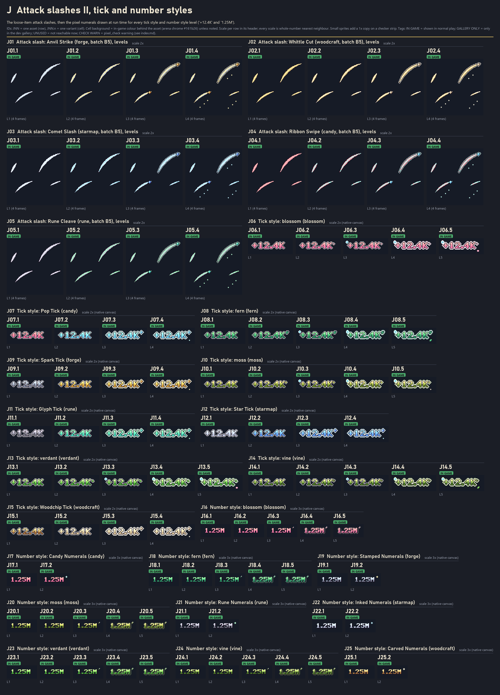

The loose-item attack slashes, then the pixel numerals drawn at run time for every tick style and number style level ('+12.4K' and '1.25M').

| ID | Asset | Cells | Source | Used in game | Notes |
| --- | --- | --- | --- | --- | --- |
| J01 | Attack slash: Anvil Strike (forge, batch B5), levels | J01.1 L1 (4 frames), J01.2 L2 (4 frames), J01.3 L3 (4 frames), J01.4 L4 (4 frames) | `cos-atk-forge-<level>.png` (4 frames of 64 px: snap, held hit, thin, break); played by `pixelSlash()` in theme/effects.ts | Arena and production hits when the attack cosmetic is equipped [game] | Each level cell shows the 4 frames as a 2 x 2 grid (read left to right, top to bottom); timing 50/130/90/110 ms. |
| J02 | Attack slash: Whittle Cut (woodcraft, batch B5), levels | J02.1 L1 (4 frames), J02.2 L2 (4 frames), J02.3 L3 (4 frames), J02.4 L4 (4 frames) | `cos-atk-woodcraft-<level>.png` (4 frames of 64 px: snap, held hit, thin, break); played by `pixelSlash()` in theme/effects.ts | Arena and production hits when the attack cosmetic is equipped [game] | Each level cell shows the 4 frames as a 2 x 2 grid (read left to right, top to bottom); timing 50/130/90/110 ms. |
| J03 | Attack slash: Comet Slash (starmap, batch B5), levels | J03.1 L1 (4 frames), J03.2 L2 (4 frames), J03.3 L3 (4 frames), J03.4 L4 (4 frames) | `cos-atk-starmap-<level>.png` (4 frames of 64 px: snap, held hit, thin, break); played by `pixelSlash()` in theme/effects.ts | Arena and production hits when the attack cosmetic is equipped [game] | Each level cell shows the 4 frames as a 2 x 2 grid (read left to right, top to bottom); timing 50/130/90/110 ms. |
| J04 | Attack slash: Ribbon Swipe (candy, batch B5), levels | J04.1 L1 (4 frames), J04.2 L2 (4 frames), J04.3 L3 (4 frames), J04.4 L4 (4 frames) | `cos-atk-candy-<level>.png` (4 frames of 64 px: snap, held hit, thin, break); played by `pixelSlash()` in theme/effects.ts | Arena and production hits when the attack cosmetic is equipped [game] | Each level cell shows the 4 frames as a 2 x 2 grid (read left to right, top to bottom); timing 50/130/90/110 ms. |
| J05 | Attack slash: Rune Cleave (rune, batch B5), levels | J05.1 L1 (4 frames), J05.2 L2 (4 frames), J05.3 L3 (4 frames), J05.4 L4 (4 frames) | `cos-atk-rune-<level>.png` (4 frames of 64 px: snap, held hit, thin, break); played by `pixelSlash()` in theme/effects.ts | Arena and production hits when the attack cosmetic is equipped [game] | Each level cell shows the 4 frames as a 2 x 2 grid (read left to right, top to bottom); timing 50/130/90/110 ms. |
| J06 | Tick style: blossom (blossom) | J06.1 L1, J06.2 L2, J06.3 L3, J06.4 L4, J06.5 L5 | `pixelTick()` in art/cosmetics.ts (5 x 7 font, style ramp, `cos-deco-*` motifs) | Floating ticks (`--bi-tick-px`) [game] | Drawn at run time; captured from the canvas at native size. |
| J07 | Tick style: Pop Tick (candy) | J07.1 L1, J07.2 L2, J07.3 L3, J07.4 L4 | `pixelTick()` in art/cosmetics.ts (5 x 7 font, style ramp, `cos-deco-*` motifs) | Floating ticks (`--bi-tick-px`) [game] | Drawn at run time; captured from the canvas at native size. |
| J08 | Tick style: fern (fern) | J08.1 L1, J08.2 L2, J08.3 L3, J08.4 L4, J08.5 L5 | `pixelTick()` in art/cosmetics.ts (5 x 7 font, style ramp, `cos-deco-*` motifs) | Floating ticks (`--bi-tick-px`) [game] | Drawn at run time; captured from the canvas at native size. |
| J09 | Tick style: Spark Tick (forge) | J09.1 L1, J09.2 L2, J09.3 L3, J09.4 L4 | `pixelTick()` in art/cosmetics.ts (5 x 7 font, style ramp, `cos-deco-*` motifs) | Floating ticks (`--bi-tick-px`) [game] | Drawn at run time; captured from the canvas at native size. |
| J10 | Tick style: moss (moss) | J10.1 L1, J10.2 L2, J10.3 L3, J10.4 L4, J10.5 L5 | `pixelTick()` in art/cosmetics.ts (5 x 7 font, style ramp, `cos-deco-*` motifs) | Floating ticks (`--bi-tick-px`) [game] | Drawn at run time; captured from the canvas at native size. |
| J11 | Tick style: Glyph Tick (rune) | J11.1 L1, J11.2 L2, J11.3 L3, J11.4 L4 | `pixelTick()` in art/cosmetics.ts (5 x 7 font, style ramp, `cos-deco-*` motifs) | Floating ticks (`--bi-tick-px`) [game] | Drawn at run time; captured from the canvas at native size. |
| J12 | Tick style: Star Tick (starmap) | J12.1 L1, J12.2 L2, J12.3 L3, J12.4 L4 | `pixelTick()` in art/cosmetics.ts (5 x 7 font, style ramp, `cos-deco-*` motifs) | Floating ticks (`--bi-tick-px`) [game] | Drawn at run time; captured from the canvas at native size. |
| J13 | Tick style: verdant (verdant) | J13.1 L1, J13.2 L2, J13.3 L3, J13.4 L4, J13.5 L5 | `pixelTick()` in art/cosmetics.ts (5 x 7 font, style ramp, `cos-deco-*` motifs) | Floating ticks (`--bi-tick-px`) [game] | Drawn at run time; captured from the canvas at native size. |
| J14 | Tick style: vine (vine) | J14.1 L1, J14.2 L2, J14.3 L3, J14.4 L4, J14.5 L5 | `pixelTick()` in art/cosmetics.ts (5 x 7 font, style ramp, `cos-deco-*` motifs) | Floating ticks (`--bi-tick-px`) [game] | Drawn at run time; captured from the canvas at native size. |
| J15 | Tick style: Woodchip Tick (woodcraft) | J15.1 L1, J15.2 L2, J15.3 L3, J15.4 L4 | `pixelTick()` in art/cosmetics.ts (5 x 7 font, style ramp, `cos-deco-*` motifs) | Floating ticks (`--bi-tick-px`) [game] | Drawn at run time; captured from the canvas at native size. |
| J16 | Number style: blossom (blossom) | J16.1 L1, J16.2 L2, J16.3 L3, J16.4 L4, J16.5 L5 | `pixelNumber()` in art/cosmetics.ts (5 x 7 font, style ramp, `cos-deco-*` motifs) | Pixel numbers (`--bi-num-px`, pixelNumbers.ts) [game] | Drawn at run time; captured from the canvas at native size. |
| J17 | Number style: Candy Numerals (candy) | J17.1 L1, J17.2 L2 | `pixelNumber()` in art/cosmetics.ts (5 x 7 font, style ramp, `cos-deco-*` motifs) | Pixel numbers (`--bi-num-px`, pixelNumbers.ts) [game] | Drawn at run time; captured from the canvas at native size. |
| J18 | Number style: fern (fern) | J18.1 L1, J18.2 L2, J18.3 L3, J18.4 L4, J18.5 L5 | `pixelNumber()` in art/cosmetics.ts (5 x 7 font, style ramp, `cos-deco-*` motifs) | Pixel numbers (`--bi-num-px`, pixelNumbers.ts) [game] | Drawn at run time; captured from the canvas at native size. |
| J19 | Number style: Stamped Numerals (forge) | J19.1 L1, J19.2 L2 | `pixelNumber()` in art/cosmetics.ts (5 x 7 font, style ramp, `cos-deco-*` motifs) | Pixel numbers (`--bi-num-px`, pixelNumbers.ts) [game] | Drawn at run time; captured from the canvas at native size. |
| J20 | Number style: moss (moss) | J20.1 L1, J20.2 L2, J20.3 L3, J20.4 L4, J20.5 L5 | `pixelNumber()` in art/cosmetics.ts (5 x 7 font, style ramp, `cos-deco-*` motifs) | Pixel numbers (`--bi-num-px`, pixelNumbers.ts) [game] | Drawn at run time; captured from the canvas at native size. |
| J21 | Number style: Rune Numerals (rune) | J21.1 L1, J21.2 L2 | `pixelNumber()` in art/cosmetics.ts (5 x 7 font, style ramp, `cos-deco-*` motifs) | Pixel numbers (`--bi-num-px`, pixelNumbers.ts) [game] | Drawn at run time; captured from the canvas at native size. |
| J22 | Number style: Inked Numerals (starmap) | J22.1 L1, J22.2 L2 | `pixelNumber()` in art/cosmetics.ts (5 x 7 font, style ramp, `cos-deco-*` motifs) | Pixel numbers (`--bi-num-px`, pixelNumbers.ts) [game] | Drawn at run time; captured from the canvas at native size. |
| J23 | Number style: verdant (verdant) | J23.1 L1, J23.2 L2, J23.3 L3, J23.4 L4, J23.5 L5 | `pixelNumber()` in art/cosmetics.ts (5 x 7 font, style ramp, `cos-deco-*` motifs) | Pixel numbers (`--bi-num-px`, pixelNumbers.ts) [game] | Drawn at run time; captured from the canvas at native size. |
| J24 | Number style: vine (vine) | J24.1 L1, J24.2 L2, J24.3 L3, J24.4 L4, J24.5 L5 | `pixelNumber()` in art/cosmetics.ts (5 x 7 font, style ramp, `cos-deco-*` motifs) | Pixel numbers (`--bi-num-px`, pixelNumbers.ts) [game] | Drawn at run time; captured from the canvas at native size. |
| J25 | Number style: Carved Numerals (woodcraft) | J25.1 L1, J25.2 L2 | `pixelNumber()` in art/cosmetics.ts (5 x 7 font, style ramp, `cos-deco-*` motifs) | Pixel numbers (`--bi-num-px`, pixelNumbers.ts) [game] | Drawn at run time; captured from the canvas at native size. |

## K: Card borders I: garden sets

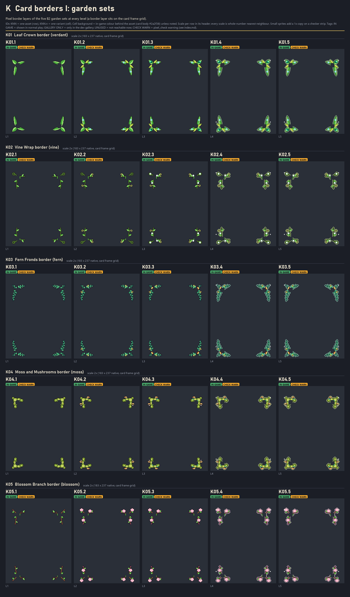

Pixel border layers of the five B2 garden sets at every level (a border layer sits on the card frame grid).

| ID | Asset | Cells | Source | Used in game | Notes |
| --- | --- | --- | --- | --- | --- |
| K01 | Leaf Crown border (verdant) | K01.1 L1, K01.2 L2, K01.3 L3, K01.4 L4, K01.5 L5 | `cos-bd-verdant-<level>.png`; recipe `bd-verdant-<n>` in theme/recipes.css; drawn by scripts/art/cosmetics | Cards at Gold star 1+ wearing it [game] | Beta batch B2 (built #68). pixel_check warnings on 5 sprite(s). |
| K02 | Vine Wrap border (vine) | K02.1 L1, K02.2 L2, K02.3 L3, K02.4 L4, K02.5 L5 | `cos-bd-vine-<level>.png`; recipe `bd-vine-<n>` in theme/recipes.css; drawn by scripts/art/cosmetics | Cards at Gold star 1+ wearing it [game] | Beta batch B2 (built #68). pixel_check warnings on 5 sprite(s). |
| K03 | Fern Fronds border (fern) | K03.1 L1, K03.2 L2, K03.3 L3, K03.4 L4, K03.5 L5 | `cos-bd-fern-<level>.png`; recipe `bd-fern-<n>` in theme/recipes.css; drawn by scripts/art/cosmetics | Cards at Gold star 1+ wearing it [game] | Beta batch B2 (built #68). pixel_check warnings on 5 sprite(s). |
| K04 | Moss and Mushrooms border (moss) | K04.1 L1, K04.2 L2, K04.3 L3, K04.4 L4, K04.5 L5 | `cos-bd-moss-<level>.png`; recipe `bd-moss-<n>` in theme/recipes.css; drawn by scripts/art/cosmetics | Cards at Gold star 1+ wearing it [game] | Beta batch B2 (built #68). pixel_check warnings on 5 sprite(s). |
| K05 | Blossom Branch border (blossom) | K05.1 L1, K05.2 L2, K05.3 L3, K05.4 L4, K05.5 L5 | `cos-bd-blossom-<level>.png`; recipe `bd-blossom-<n>` in theme/recipes.css; drawn by scripts/art/cosmetics | Cards at Gold star 1+ wearing it [game] | Beta batch B2 (built #68). pixel_check warnings on 5 sprite(s). |

## L: Card borders II: Moonwood Dryad exclusives

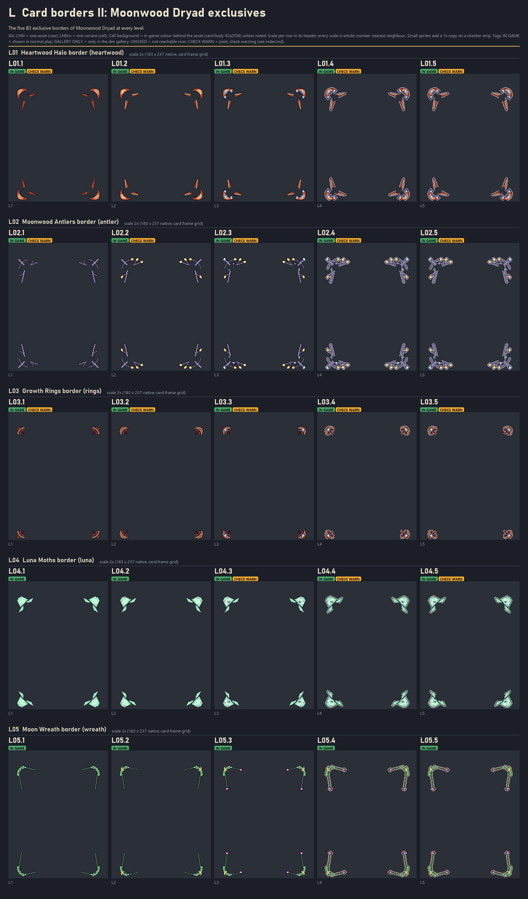

The five B3 exclusive borders of Moonwood Dryad at every level.

| ID | Asset | Cells | Source | Used in game | Notes |
| --- | --- | --- | --- | --- | --- |
| L01 | Heartwood Halo border (heartwood) | L01.1 L1, L01.2 L2, L01.3 L3, L01.4 L4, L01.5 L5 | `cos-bd-heartwood-<level>.png`; recipe `bd-heartwood-<n>` | Moonwood Dryad at Prismatic star 6 [game] | Beta batch B3 (built #68). pixel_check warnings on 5 sprite(s). |
| L02 | Moonwood Antlers border (antler) | L02.1 L1, L02.2 L2, L02.3 L3, L02.4 L4, L02.5 L5 | `cos-bd-antler-<level>.png`; recipe `bd-antler-<n>` | Moonwood Dryad at Prismatic star 6 [game] | Beta batch B3 (built #68). pixel_check warnings on 5 sprite(s). |
| L03 | Growth Rings border (rings) | L03.1 L1, L03.2 L2, L03.3 L3, L03.4 L4, L03.5 L5 | `cos-bd-rings-<level>.png`; recipe `bd-rings-<n>` | Moonwood Dryad at Prismatic star 6 [game] | Beta batch B3 (built #68). pixel_check warnings on 5 sprite(s). |
| L04 | Luna Moths border (luna) | L04.1 L1, L04.2 L2, L04.3 L3, L04.4 L4, L04.5 L5 | `cos-bd-luna-<level>.png`; recipe `bd-luna-<n>` | Moonwood Dryad at Prismatic star 6 [game] | Beta batch B3 (built #68). pixel_check warnings on 3 sprite(s). |
| L05 | Moon Wreath border (wreath) | L05.1 L1, L05.2 L2, L05.3 L3, L05.4 L4, L05.5 L5 | `cos-bd-wreath-<level>.png`; recipe `bd-wreath-<n>` | Moonwood Dryad at Prismatic star 6 [game] | Beta batch B3 (built #68). |

## M: Card finishes I: garden sets

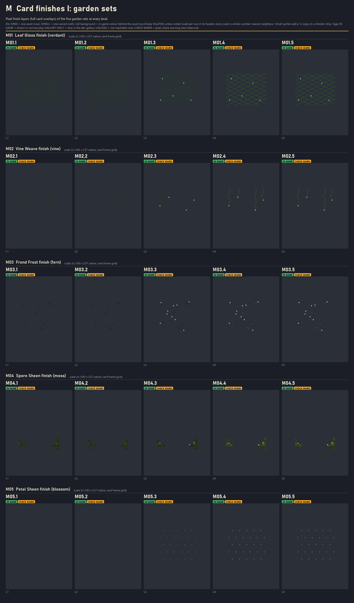

Pixel finish layers (full-card overlays) of the five garden sets at every level.

| ID | Asset | Cells | Source | Used in game | Notes |
| --- | --- | --- | --- | --- | --- |
| M01 | Leaf Gloss finish (verdant) | M01.1 L1, M01.2 L2, M01.3 L3, M01.4 L4, M01.5 L5 | `cos-fn-verdant-<level>.png`; recipe `fn-verdant-<n>` | Cards at Prismatic star 1+ wearing it [game] | Beta batch B2. pixel_check warnings on 5 sprite(s). |
| M02 | Vine Weave finish (vine) | M02.1 L1, M02.2 L2, M02.3 L3, M02.4 L4, M02.5 L5 | `cos-fn-vine-<level>.png`; recipe `fn-vine-<n>` | Cards at Prismatic star 1+ wearing it [game] | Beta batch B2. pixel_check warnings on 5 sprite(s). |
| M03 | Frond Frost finish (fern) | M03.1 L1, M03.2 L2, M03.3 L3, M03.4 L4, M03.5 L5 | `cos-fn-fern-<level>.png`; recipe `fn-fern-<n>` | Cards at Prismatic star 1+ wearing it [game] | Beta batch B2. pixel_check warnings on 5 sprite(s). |
| M04 | Spore Sheen finish (moss) | M04.1 L1, M04.2 L2, M04.3 L3, M04.4 L4, M04.5 L5 | `cos-fn-moss-<level>.png`; recipe `fn-moss-<n>` | Cards at Prismatic star 1+ wearing it [game] | Beta batch B2. pixel_check warnings on 5 sprite(s). |
| M05 | Petal Sheen finish (blossom) | M05.1 L1, M05.2 L2, M05.3 L3, M05.4 L4, M05.5 L5 | `cos-fn-blossom-<level>.png`; recipe `fn-blossom-<n>` | Cards at Prismatic star 1+ wearing it [game] | Beta batch B2. pixel_check warnings on 5 sprite(s). |

## N: Card finishes II: Core Titan exclusives

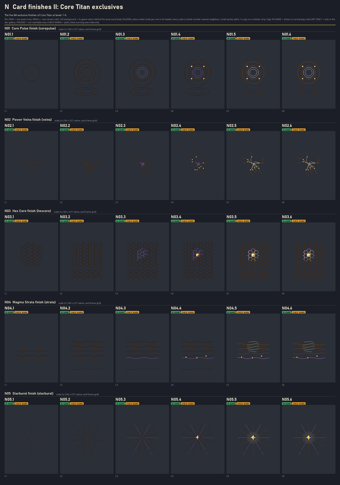

The five B4 exclusive finishes of Core Titan at levels 1-6.

| ID | Asset | Cells | Source | Used in game | Notes |
| --- | --- | --- | --- | --- | --- |
| N01 | Core Pulse finish (corepulse) | N01.1 L1, N01.2 L2, N01.3 L3, N01.4 L4, N01.5 L5, N01.6 L6 | `cos-fn-corepulse-<level>.png`; recipe `fn-corepulse-<n>` | Core Titan at Prismatic star 6 [game] | Beta batch B4. pixel_check warnings on 6 sprite(s). |
| N02 | Power Veins finish (veins) | N02.1 L1, N02.2 L2, N02.3 L3, N02.4 L4, N02.5 L5, N02.6 L6 | `cos-fn-veins-<level>.png`; recipe `fn-veins-<n>` | Core Titan at Prismatic star 6 [game] | Beta batch B4. pixel_check warnings on 6 sprite(s). |
| N03 | Hex Core finish (hexcore) | N03.1 L1, N03.2 L2, N03.3 L3, N03.4 L4, N03.5 L5, N03.6 L6 | `cos-fn-hexcore-<level>.png`; recipe `fn-hexcore-<n>` | Core Titan at Prismatic star 6 [game] | Beta batch B4. pixel_check warnings on 6 sprite(s). |
| N04 | Magma Strata finish (strata) | N04.1 L1, N04.2 L2, N04.3 L3, N04.4 L4, N04.5 L5, N04.6 L6 | `cos-fn-strata-<level>.png`; recipe `fn-strata-<n>` | Core Titan at Prismatic star 6 [game] | Beta batch B4. pixel_check warnings on 6 sprite(s). |
| N05 | Starburst finish (starburst) | N05.1 L1, N05.2 L2, N05.3 L3, N05.4 L4, N05.5 L5, N05.6 L6 | `cos-fn-starburst-<level>.png`; recipe `fn-starburst-<n>` | Core Titan at Prismatic star 6 [game] | Beta batch B4. pixel_check warnings on 6 sprite(s). |

## O: Loose borders, corner flourishes, finish pulses

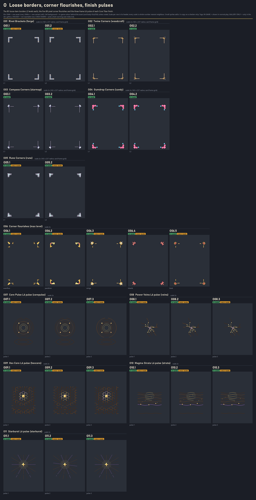

The B5 loose-item borders (2 levels each), the five B9 pixel corner flourishes and the three-frame L6 pulse of each Core Titan finish.

| ID | Asset | Cells | Source | Used in game | Notes |
| --- | --- | --- | --- | --- | --- |
| O01 | Rivet Brackets (forge) | O01.1 L1, O01.2 L2 | `cos-bd-forge-1..2.png` | Cards at Gold star 1+ wearing it [game] | Beta batch B5. pixel_check warnings on 2 sprite(s). |
| O02 | Twine Corners (woodcraft) | O02.1 L1, O02.2 L2 | `cos-bd-woodcraft-1..2.png` | Cards at Gold star 1+ wearing it [game] | Beta batch B5. |
| O03 | Compass Corners (starmap) | O03.1 L1, O03.2 L2 | `cos-bd-starmap-1..2.png` | Cards at Gold star 1+ wearing it [game] | Beta batch B5. |
| O04 | Gumdrop Corners (candy) | O04.1 L1, O04.2 L2 | `cos-bd-candy-1..2.png` | Cards at Gold star 1+ wearing it [game] | Beta batch B5. |
| O05 | Rune Corners (rune) | O05.1 L1, O05.2 L2 | `cos-bd-rune-1..2.png` | Cards at Gold star 1+ wearing it [game] | Beta batch B5. pixel_check warnings on 2 sprite(s). |
| O06 | Corner flourishes (max level) | O06.1 acanthus, O06.2 pauldron, O06.3 wings, O06.4 shards, O06.5 knot | `cos-corner-<shape>.png`; recipe `corner-<shape>` | Max-level borders (see COSMETIC_ART_IDS.md) [game] | Beta batch B9. pixel_check warnings on 5 sprite(s). |
| O07 | Core Pulse L6 pulse (corepulse) | O07.1 pulse 1, O07.2 pulse 2, O07.3 pulse 3 | `cos-fnp-corepulse.png` (3 frames of 183 x 237) | Core Titan finish at level 6 [game] | Beta batch B4. pixel_check warnings on 3 sprite(s). |
| O08 | Power Veins L6 pulse (veins) | O08.1 pulse 1, O08.2 pulse 2, O08.3 pulse 3 | `cos-fnp-veins.png` (3 frames of 183 x 237) | Core Titan finish at level 6 [game] | Beta batch B4. pixel_check warnings on 3 sprite(s). |
| O09 | Hex Core L6 pulse (hexcore) | O09.1 pulse 1, O09.2 pulse 2, O09.3 pulse 3 | `cos-fnp-hexcore.png` (3 frames of 183 x 237) | Core Titan finish at level 6 [game] | Beta batch B4. pixel_check warnings on 3 sprite(s). |
| O10 | Magma Strata L6 pulse (strata) | O10.1 pulse 1, O10.2 pulse 2, O10.3 pulse 3 | `cos-fnp-strata.png` (3 frames of 183 x 237) | Core Titan finish at level 6 [game] | Beta batch B4. pixel_check warnings on 3 sprite(s). |
| O11 | Starburst L6 pulse (starburst) | O11.1 pulse 1, O11.2 pulse 2, O11.3 pulse 3 | `cos-fnp-starburst.png` (3 frames of 183 x 237) | Core Titan finish at level 6 [game] | Beta batch B4. pixel_check warnings on 3 sprite(s). |

## P: Card cosmetics drawn in CSS (no sprite)

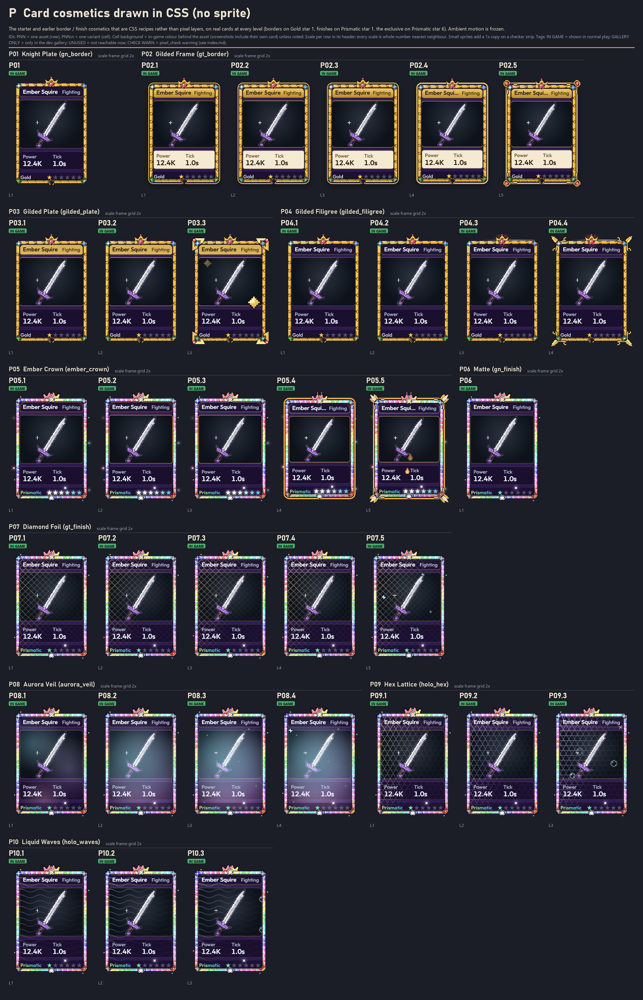

The starter and earlier border / finish cosmetics that are CSS recipes rather than pixel layers, on real cards at every level (borders on Gold star 1, finishes on Prismatic star 1, the exclusive on Prismatic star 6). Ambient motion is frozen.

| ID | Asset | Cells | Source | Used in game | Notes |
| --- | --- | --- | --- | --- | --- |
| P01 | Knight Plate (gn_border) | L1 | theme/recipes.css recipes: knight-plate | Cards wearing gn_border [game] | CSS gradients / shapes (pre-pixel). Particles of `ambient-*` use the `cos-pt-*` pixel sprites (sheet Q). |
| P02 | Gilded Frame (gt_border) | P02.1 L1, P02.2 L2, P02.3 L3, P02.4 L4, P02.5 L5 | theme/recipes.css recipes: ambient-glints, ambient-pop, flourish-corners, frame-tradition | Cards wearing gt_border [game] | CSS gradients / shapes (pre-pixel). Particles of `ambient-*` use the `cos-pt-*` pixel sprites (sheet Q). |
| P03 | Gilded Plate (gilded_plate) | P03.1 L1, P03.2 L2, P03.3 L3 | theme/recipes.css recipes: ambient-motes, ambient-pair, flourish-corners, inner-gilt | Cards wearing gilded_plate [game] | CSS gradients / shapes (pre-pixel). Particles of `ambient-*` use the `cos-pt-*` pixel sprites (sheet Q). |
| P04 | Gilded Filigree (gilded_filigree) | P04.1 L1, P04.2 L2, P04.3 L3, P04.4 L4 | theme/recipes.css recipes: ambient-glints, ambient-rail, filigree-1, filigree-2, filigree-3, flourish-corners | Cards wearing gilded_filigree [game] | CSS gradients / shapes (pre-pixel). Particles of `ambient-*` use the `cos-pt-*` pixel sprites (sheet Q). |
| P05 | Ember Crown (ember_crown) | P05.1 L1, P05.2 L2, P05.3 L3, P05.4 L4, P05.5 L5 | theme/recipes.css recipes: ambient-embers, ambient-fountain, corner-wings, crown, flourish-corners | Cards wearing ember_crown [game] | CSS gradients / shapes (pre-pixel). Particles of `ambient-*` use the `cos-pt-*` pixel sprites (sheet Q). |
| P06 | Matte (gn_finish) | L1 | theme/recipes.css recipes: none (tokens only) | Cards wearing gn_finish [game] | CSS gradients / shapes (pre-pixel). Particles of `ambient-*` use the `cos-pt-*` pixel sprites (sheet Q). |
| P07 | Diamond Foil (gt_finish) | P07.1 L1, P07.2 L2, P07.3 L3, P07.4 L4, P07.5 L5 | theme/recipes.css recipes: ambient-pop-f, ambient-stars, holo-diamond | Cards wearing gt_finish [game] | CSS gradients / shapes (pre-pixel). Particles of `ambient-*` use the `cos-pt-*` pixel sprites (sheet Q). |
| P08 | Aurora Veil (aurora_veil) | P08.1 L1, P08.2 L2, P08.3 L3, P08.4 L4 | theme/recipes.css recipes: ambient-orbit-f, ambient-stars, holo-aurora, holo-aurora-flow, holo-sparkle | Cards wearing aurora_veil [game] | CSS gradients / shapes (pre-pixel). Particles of `ambient-*` use the `cos-pt-*` pixel sprites (sheet Q). |
| P09 | Hex Lattice (holo_hex) | P09.1 L1, P09.2 L2, P09.3 L3 | theme/recipes.css recipes: ambient-fountain-f, ambient-glints, holo-hex | Cards wearing holo_hex [game] | CSS gradients / shapes (pre-pixel). Particles of `ambient-*` use the `cos-pt-*` pixel sprites (sheet Q). |
| P10 | Liquid Waves (holo_waves) | P10.1 L1, P10.2 L2, P10.3 L3 | theme/recipes.css recipes: ambient-bubbles, ambient-rail-f, holo-waves | Cards wearing holo_waves [game] | CSS gradients / shapes (pre-pixel). Particles of `ambient-*` use the `cos-pt-*` pixel sprites (sheet Q). |

## Q: Tables, cursors, particles and decorations

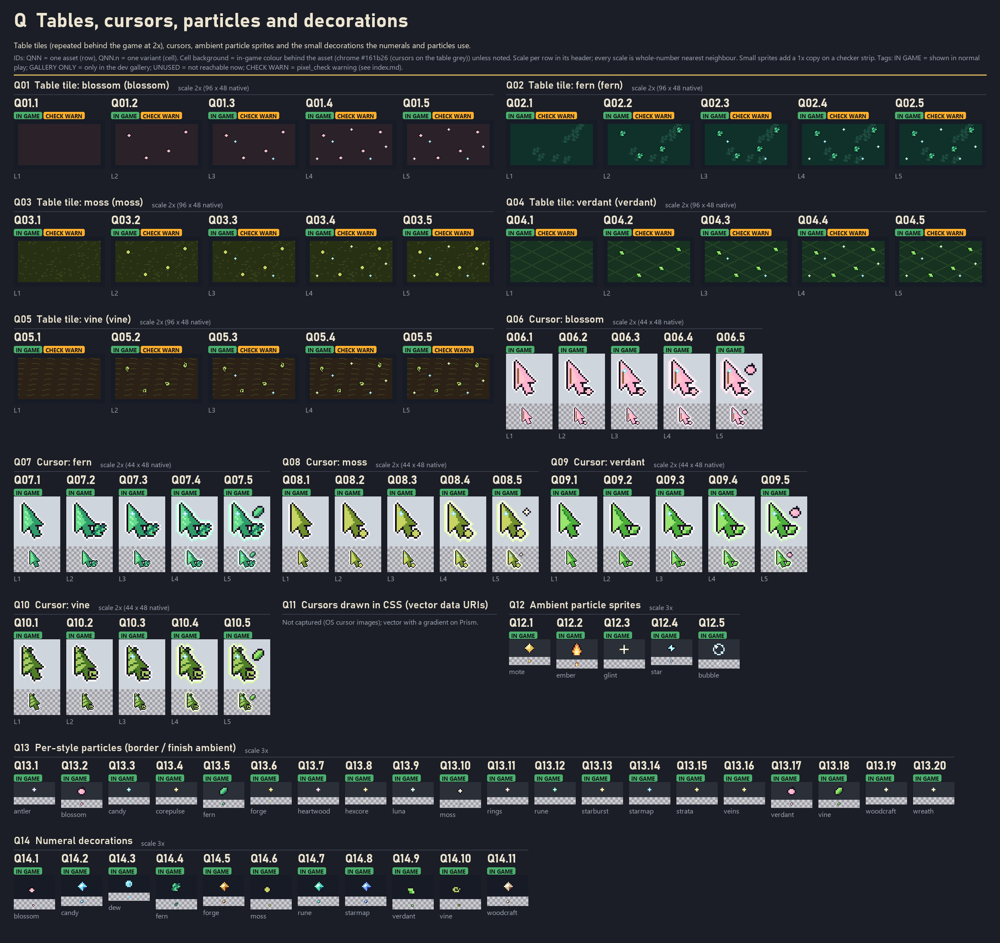

Table tiles (repeated behind the game at 2x), cursors, ambient particle sprites and the small decorations the numerals and particles use.

| ID | Asset | Cells | Source | Used in game | Notes |
| --- | --- | --- | --- | --- | --- |
| Q01 | Table tile: blossom (blossom) | Q01.1 L1, Q01.2 L2, Q01.3 L3, Q01.4 L4, Q01.5 L5 | `cos-tb-blossom-<level>.png`; recipe `tb-blossom-<n>` | Page background (table) when equipped [game] | Beta batch B2. 96 x 48 tile, repeated. pixel_check warnings on 5 sprite(s). |
| Q02 | Table tile: fern (fern) | Q02.1 L1, Q02.2 L2, Q02.3 L3, Q02.4 L4, Q02.5 L5 | `cos-tb-fern-<level>.png`; recipe `tb-fern-<n>` | Page background (table) when equipped [game] | Beta batch B2. 96 x 48 tile, repeated. pixel_check warnings on 5 sprite(s). |
| Q03 | Table tile: moss (moss) | Q03.1 L1, Q03.2 L2, Q03.3 L3, Q03.4 L4, Q03.5 L5 | `cos-tb-moss-<level>.png`; recipe `tb-moss-<n>` | Page background (table) when equipped [game] | Beta batch B2. 96 x 48 tile, repeated. pixel_check warnings on 5 sprite(s). |
| Q04 | Table tile: verdant (verdant) | Q04.1 L1, Q04.2 L2, Q04.3 L3, Q04.4 L4, Q04.5 L5 | `cos-tb-verdant-<level>.png`; recipe `tb-verdant-<n>` | Page background (table) when equipped [game] | Beta batch B2. 96 x 48 tile, repeated. pixel_check warnings on 5 sprite(s). |
| Q05 | Table tile: vine (vine) | Q05.1 L1, Q05.2 L2, Q05.3 L3, Q05.4 L4, Q05.5 L5 | `cos-tb-vine-<level>.png`; recipe `tb-vine-<n>` | Page background (table) when equipped [game] | Beta batch B2. 96 x 48 tile, repeated. pixel_check warnings on 5 sprite(s). |
| Q06 | Cursor: blossom | Q06.1 L1, Q06.2 L2, Q06.3 L3, Q06.4 L4, Q06.5 L5 | `cos-cur-blossom-<level>.png`; recipe `cur-blossom-<n>` | Mouse cursor when equipped [game] | Beta batch B2. Hotspot at the tip. |
| Q07 | Cursor: fern | Q07.1 L1, Q07.2 L2, Q07.3 L3, Q07.4 L4, Q07.5 L5 | `cos-cur-fern-<level>.png`; recipe `cur-fern-<n>` | Mouse cursor when equipped [game] | Beta batch B2. Hotspot at the tip. |
| Q08 | Cursor: moss | Q08.1 L1, Q08.2 L2, Q08.3 L3, Q08.4 L4, Q08.5 L5 | `cos-cur-moss-<level>.png`; recipe `cur-moss-<n>` | Mouse cursor when equipped [game] | Beta batch B2. Hotspot at the tip. |
| Q09 | Cursor: verdant | Q09.1 L1, Q09.2 L2, Q09.3 L3, Q09.4 L4, Q09.5 L5 | `cos-cur-verdant-<level>.png`; recipe `cur-verdant-<n>` | Mouse cursor when equipped [game] | Beta batch B2. Hotspot at the tip. |
| Q10 | Cursor: vine | Q10.1 L1, Q10.2 L2, Q10.3 L3, Q10.4 L4, Q10.5 L5 | `cos-cur-vine-<level>.png`; recipe `cur-vine-<n>` | Mouse cursor when equipped [game] | Beta batch B2. Hotspot at the tip. |
| Q11 | Cursors drawn in CSS (vector data URIs) | not captured | theme/recipes.css `cursor-gilded`, `cursor-crimson`, `cursor-prism` (SVG data URIs) | Starter, Gilded Tradition, Prism Pointer cursors | Not captured (OS cursor images); vector with a gradient on Prism. |
| Q12 | Ambient particle sprites | Q12.1 mote, Q12.2 ember, Q12.3 glint, Q12.4 star, Q12.5 bubble | `cos-pt-*.png`; used by the `ambient-*` recipes | Max-level border / finish particles [game] |  pixel_check warnings on 1 sprite(s). |
| Q13 | Per-style particles (border / finish ambient) | Q13.1 antler, Q13.2 blossom, Q13.3 candy, Q13.4 corepulse, Q13.5 fern, Q13.6 forge, Q13.7 heartwood, Q13.8 hexcore, Q13.9 luna, Q13.10 moss, Q13.11 rings, Q13.12 rune, Q13.13 starburst, Q13.14 starmap, Q13.15 strata, Q13.16 veins, Q13.17 verdant, Q13.18 vine, Q13.19 woodcraft, Q13.20 wreath | `cos-amb-<style>.png` | Ambient particles of that style's border / finish; also tick petals [game] |  |
| Q14 | Numeral decorations | Q14.1 blossom, Q14.2 candy, Q14.3 dew, Q14.4 fern, Q14.5 forge, Q14.6 moss, Q14.7 rune, Q14.8 starmap, Q14.9 verdant, Q14.10 vine, Q14.11 woodcraft | `cos-deco-<style>.png`; pasted by `pixelTick()` | Tick numerals at level 2+ (motifs, gems, dew) [game] |  |

## R: Achievement stickers

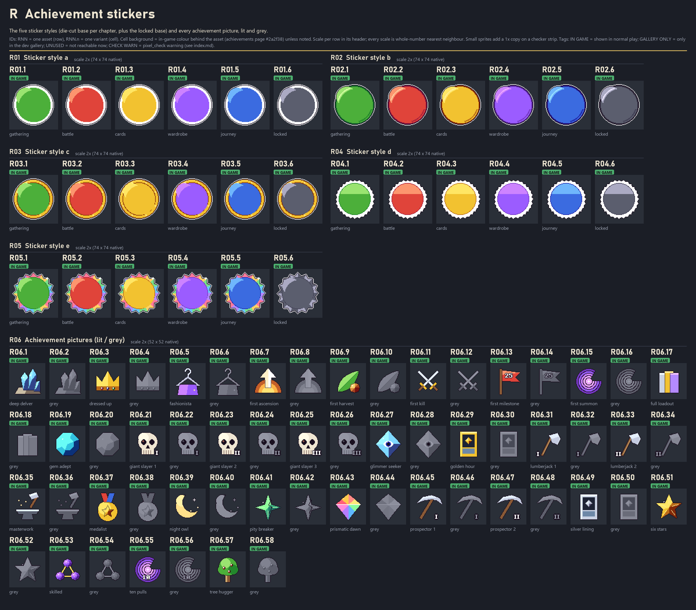

The five sticker styles (die-cut base per chapter, plus the locked base) and every achievement picture, lit and grey.

| ID | Asset | Cells | Source | Used in game | Notes |
| --- | --- | --- | --- | --- | --- |
| R01 | Sticker style a | R01.1 gathering, R01.2 battle, R01.3 cards, R01.4 wardrobe, R01.5 journey, R01.6 locked | `cos-sticker-a-<chapter\|locked>.png`; `stickerArt()` | Achievements sticker book (equipped style) [game] | Beta batch B6. |
| R02 | Sticker style b | R02.1 gathering, R02.2 battle, R02.3 cards, R02.4 wardrobe, R02.5 journey, R02.6 locked | `cos-sticker-b-<chapter\|locked>.png`; `stickerArt()` | Achievements sticker book (equipped style) [game] | Beta batch B6. |
| R03 | Sticker style c | R03.1 gathering, R03.2 battle, R03.3 cards, R03.4 wardrobe, R03.5 journey, R03.6 locked | `cos-sticker-c-<chapter\|locked>.png`; `stickerArt()` | Achievements sticker book (equipped style) [game] | Beta batch B6. |
| R04 | Sticker style d | R04.1 gathering, R04.2 battle, R04.3 cards, R04.4 wardrobe, R04.5 journey, R04.6 locked | `cos-sticker-d-<chapter\|locked>.png`; `stickerArt()` | Achievements sticker book (equipped style) [game] | Beta batch B6. |
| R05 | Sticker style e | R05.1 gathering, R05.2 battle, R05.3 cards, R05.4 wardrobe, R05.5 journey, R05.6 locked | `cos-sticker-e-<chapter\|locked>.png`; `stickerArt()` | Achievements sticker book (equipped style) [game] | Beta batch B6. |
| R06 | Achievement pictures (lit / grey) | R06.1 deep delver, R06.2 grey, R06.3 dressed up, R06.4 grey, R06.5 fashionista, R06.6 grey, R06.7 first ascension, R06.8 grey, R06.9 first harvest, R06.10 grey, R06.11 first kill, R06.12 grey, R06.13 first milestone, R06.14 grey, R06.15 first summon, R06.16 grey, R06.17 full loadout, R06.18 grey, R06.19 gem adept, R06.20 grey, R06.21 giant slayer 1, R06.22 grey, R06.23 giant slayer 2, R06.24 grey, R06.25 giant slayer 3, R06.26 grey, R06.27 glimmer seeker, R06.28 grey, R06.29 golden hour, R06.30 grey, R06.31 lumberjack 1, R06.32 grey, R06.33 lumberjack 2, R06.34 grey, R06.35 masterwork, R06.36 grey, R06.37 medalist, R06.38 grey, R06.39 night owl, R06.40 grey, R06.41 pity breaker, R06.42 grey, R06.43 prismatic dawn, R06.44 grey, R06.45 prospector 1, R06.46 grey, R06.47 prospector 2, R06.48 grey, R06.49 silver lining, R06.50 grey, R06.51 six stars, R06.52 grey, R06.53 skilled, R06.54 grey, R06.55 ten pulls, R06.56 grey, R06.57 tree hugger, R06.58 grey | `cos-ach-<id>[-grey].png`; pasted on the sticker by `stickerArt()` | Achievements page [game] | Beta batch B6. Pairs: lit then grey. pixel_check warnings on 2 sprite(s). |

## S: Skill nodes and star charts

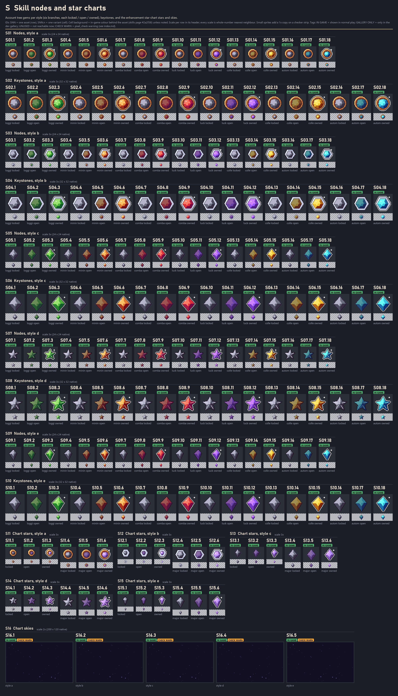

Account tree gems per style (six branches, each locked / open / owned), keystones, and the enhancement star-chart stars and skies.

| ID | Asset | Cells | Source | Used in game | Notes |
| --- | --- | --- | --- | --- | --- |
| S01 | Nodes, style a | S01.1 loggi locked, S01.2 loggi open, S01.3 loggi owned, S01.4 minin locked, S01.5 minin open, S01.6 minin owned, S01.7 comba locked, S01.8 comba open, S01.9 comba owned, S01.10 luck locked, S01.11 luck open, S01.12 luck owned, S01.13 colle locked, S01.14 colle open, S01.15 colle owned, S01.16 autom locked, S01.17 autom open, S01.18 autom owned | `cos-node-a-<branch>-<state>.png`; `skillNode()` | Skills page (equipped nodes style) [game] | Beta batch B7. |
| S02 | Keystones, style a | S02.1 loggi locked, S02.2 loggi open, S02.3 loggi owned, S02.4 minin locked, S02.5 minin open, S02.6 minin owned, S02.7 comba locked, S02.8 comba open, S02.9 comba owned, S02.10 luck locked, S02.11 luck open, S02.12 luck owned, S02.13 colle locked, S02.14 colle open, S02.15 colle owned, S02.16 autom locked, S02.17 autom open, S02.18 autom owned | `cos-key-a-<branch>-<state>.png`; `skillNode()` | Skills page (equipped nodes style) [game] | Beta batch B7. |
| S03 | Nodes, style b | S03.1 loggi locked, S03.2 loggi open, S03.3 loggi owned, S03.4 minin locked, S03.5 minin open, S03.6 minin owned, S03.7 comba locked, S03.8 comba open, S03.9 comba owned, S03.10 luck locked, S03.11 luck open, S03.12 luck owned, S03.13 colle locked, S03.14 colle open, S03.15 colle owned, S03.16 autom locked, S03.17 autom open, S03.18 autom owned | `cos-node-b-<branch>-<state>.png`; `skillNode()` | Skills page (equipped nodes style) [game] | Beta batch B7. |
| S04 | Keystones, style b | S04.1 loggi locked, S04.2 loggi open, S04.3 loggi owned, S04.4 minin locked, S04.5 minin open, S04.6 minin owned, S04.7 comba locked, S04.8 comba open, S04.9 comba owned, S04.10 luck locked, S04.11 luck open, S04.12 luck owned, S04.13 colle locked, S04.14 colle open, S04.15 colle owned, S04.16 autom locked, S04.17 autom open, S04.18 autom owned | `cos-key-b-<branch>-<state>.png`; `skillNode()` | Skills page (equipped nodes style) [game] | Beta batch B7. |
| S05 | Nodes, style c | S05.1 loggi locked, S05.2 loggi open, S05.3 loggi owned, S05.4 minin locked, S05.5 minin open, S05.6 minin owned, S05.7 comba locked, S05.8 comba open, S05.9 comba owned, S05.10 luck locked, S05.11 luck open, S05.12 luck owned, S05.13 colle locked, S05.14 colle open, S05.15 colle owned, S05.16 autom locked, S05.17 autom open, S05.18 autom owned | `cos-node-c-<branch>-<state>.png`; `skillNode()` | Skills page (equipped nodes style) [game] | Beta batch B7. pixel_check warnings on 12 sprite(s). |
| S06 | Keystones, style c | S06.1 loggi locked, S06.2 loggi open, S06.3 loggi owned, S06.4 minin locked, S06.5 minin open, S06.6 minin owned, S06.7 comba locked, S06.8 comba open, S06.9 comba owned, S06.10 luck locked, S06.11 luck open, S06.12 luck owned, S06.13 colle locked, S06.14 colle open, S06.15 colle owned, S06.16 autom locked, S06.17 autom open, S06.18 autom owned | `cos-key-c-<branch>-<state>.png`; `skillNode()` | Skills page (equipped nodes style) [game] | Beta batch B7. pixel_check warnings on 12 sprite(s). |
| S07 | Nodes, style d | S07.1 loggi locked, S07.2 loggi open, S07.3 loggi owned, S07.4 minin locked, S07.5 minin open, S07.6 minin owned, S07.7 comba locked, S07.8 comba open, S07.9 comba owned, S07.10 luck locked, S07.11 luck open, S07.12 luck owned, S07.13 colle locked, S07.14 colle open, S07.15 colle owned, S07.16 autom locked, S07.17 autom open, S07.18 autom owned | `cos-node-d-<branch>-<state>.png`; `skillNode()` | Skills page (equipped nodes style) [game] | Beta batch B7. |
| S08 | Keystones, style d | S08.1 loggi locked, S08.2 loggi open, S08.3 loggi owned, S08.4 minin locked, S08.5 minin open, S08.6 minin owned, S08.7 comba locked, S08.8 comba open, S08.9 comba owned, S08.10 luck locked, S08.11 luck open, S08.12 luck owned, S08.13 colle locked, S08.14 colle open, S08.15 colle owned, S08.16 autom locked, S08.17 autom open, S08.18 autom owned | `cos-key-d-<branch>-<state>.png`; `skillNode()` | Skills page (equipped nodes style) [game] | Beta batch B7. |
| S09 | Nodes, style e | S09.1 loggi locked, S09.2 loggi open, S09.3 loggi owned, S09.4 minin locked, S09.5 minin open, S09.6 minin owned, S09.7 comba locked, S09.8 comba open, S09.9 comba owned, S09.10 luck locked, S09.11 luck open, S09.12 luck owned, S09.13 colle locked, S09.14 colle open, S09.15 colle owned, S09.16 autom locked, S09.17 autom open, S09.18 autom owned | `cos-node-e-<branch>-<state>.png`; `skillNode()` | Skills page (equipped nodes style) [game] | Beta batch B7. |
| S10 | Keystones, style e | S10.1 loggi locked, S10.2 loggi open, S10.3 loggi owned, S10.4 minin locked, S10.5 minin open, S10.6 minin owned, S10.7 comba locked, S10.8 comba open, S10.9 comba owned, S10.10 luck locked, S10.11 luck open, S10.12 luck owned, S10.13 colle locked, S10.14 colle open, S10.15 colle owned, S10.16 autom locked, S10.17 autom open, S10.18 autom owned | `cos-key-e-<branch>-<state>.png`; `skillNode()` | Skills page (equipped nodes style) [game] | Beta batch B7. |
| S11 | Chart stars, style a | S11.1 locked, S11.2 open, S11.3 owned, S11.4 major locked, S11.5 major open, S11.6 major owned | `cos-chart-a-*`, `cos-chartmajor-a-*`; `starChart()` | Card enhancement star chart [game] | Beta batch B7. |
| S12 | Chart stars, style b | S12.1 locked, S12.2 open, S12.3 owned, S12.4 major locked, S12.5 major open, S12.6 major owned | `cos-chart-b-*`, `cos-chartmajor-b-*`; `starChart()` | Card enhancement star chart [game] | Beta batch B7. |
| S13 | Chart stars, style c | S13.1 locked, S13.2 open, S13.3 owned, S13.4 major locked, S13.5 major open, S13.6 major owned | `cos-chart-c-*`, `cos-chartmajor-c-*`; `starChart()` | Card enhancement star chart [game] | Beta batch B7. pixel_check warnings on 4 sprite(s). |
| S14 | Chart stars, style d | S14.1 locked, S14.2 open, S14.3 owned, S14.4 major locked, S14.5 major open, S14.6 major owned | `cos-chart-d-*`, `cos-chartmajor-d-*`; `starChart()` | Card enhancement star chart [game] | Beta batch B7. |
| S15 | Chart stars, style e | S15.1 locked, S15.2 open, S15.3 owned, S15.4 major locked, S15.5 major open, S15.6 major owned | `cos-chart-e-*`, `cos-chartmajor-e-*`; `starChart()` | Card enhancement star chart [game] | Beta batch B7. |
| S16 | Chart skies | S16.1 style a, S16.2 style b, S16.3 style c, S16.4 style d, S16.5 style e | `cos-chartsky-<style>.png` | Card enhancement star chart background [game] | Beta batch B7. pixel_check warnings on 5 sprite(s). |

## T: Wardrobe chrome

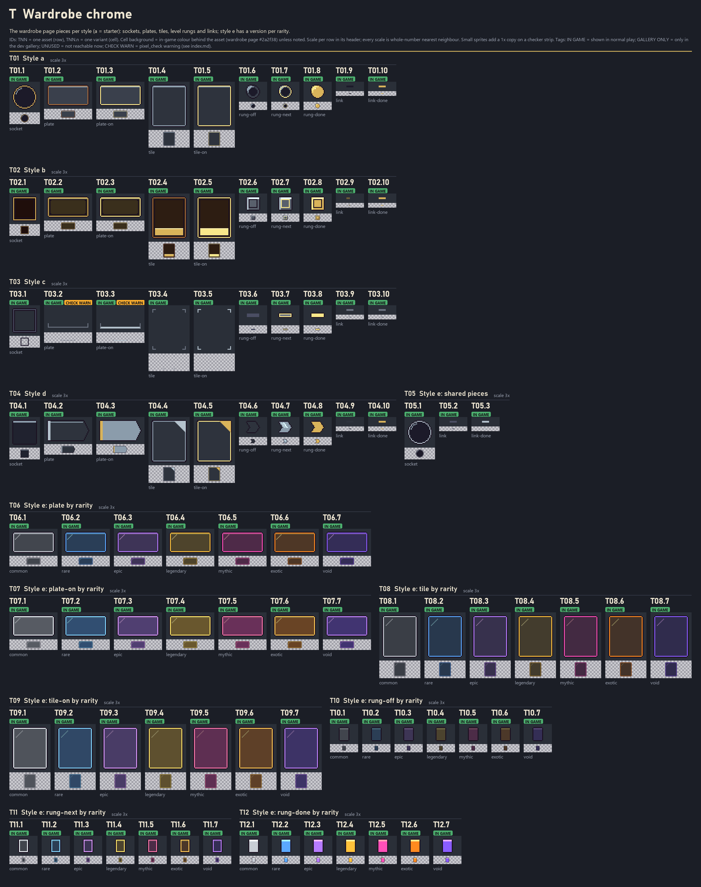

The wardrobe page pieces per style (a = starter): sockets, plates, tiles, level rungs and links; style e has a version per rarity.

| ID | Asset | Cells | Source | Used in game | Notes |
| --- | --- | --- | --- | --- | --- |
| T01 | Style a | T01.1 socket, T01.2 plate, T01.3 plate-on, T01.4 tile, T01.5 tile-on, T01.6 rung-off, T01.7 rung-next, T01.8 rung-done, T01.9 link, T01.10 link-done | `cos-wd-a-<part>.png`; `wardrobeChrome()` / `chromeCss()` | Wardrobe page (equipped style) [game] | Beta batch B10. Plates and tiles are 9-slice pieces. pixel_check warnings on 2 sprite(s). |
| T02 | Style b | T02.1 socket, T02.2 plate, T02.3 plate-on, T02.4 tile, T02.5 tile-on, T02.6 rung-off, T02.7 rung-next, T02.8 rung-done, T02.9 link, T02.10 link-done | `cos-wd-b-<part>.png`; `wardrobeChrome()` / `chromeCss()` | Wardrobe page (equipped style) [game] | Beta batch B10. Plates and tiles are 9-slice pieces. pixel_check warnings on 2 sprite(s). |
| T03 | Style c | T03.1 socket, T03.2 plate, T03.3 plate-on, T03.4 tile, T03.5 tile-on, T03.6 rung-off, T03.7 rung-next, T03.8 rung-done, T03.9 link, T03.10 link-done | `cos-wd-c-<part>.png`; `wardrobeChrome()` / `chromeCss()` | Wardrobe page (equipped style) [game] | Beta batch B10. Plates and tiles are 9-slice pieces. pixel_check warnings on 7 sprite(s). |
| T04 | Style d | T04.1 socket, T04.2 plate, T04.3 plate-on, T04.4 tile, T04.5 tile-on, T04.6 rung-off, T04.7 rung-next, T04.8 rung-done, T04.9 link, T04.10 link-done | `cos-wd-d-<part>.png`; `wardrobeChrome()` / `chromeCss()` | Wardrobe page (equipped style) [game] | Beta batch B10. Plates and tiles are 9-slice pieces. pixel_check warnings on 2 sprite(s). |
| T05 | Style e: shared pieces | T05.1 socket, T05.2 link, T05.3 link-done | `cos-wd-e-<part>.png` | Wardrobe page [game] | Beta batch B10. pixel_check warnings on 2 sprite(s). |
| T06 | Style e: plate by rarity | T06.1 common, T06.2 rare, T06.3 epic, T06.4 legendary, T06.5 mythic, T06.6 exotic, T06.7 void | `cos-wd-e-plate-<rarity>.png` | Wardrobe page (rarity glass) [game] | Beta batch B10. |
| T07 | Style e: plate-on by rarity | T07.1 common, T07.2 rare, T07.3 epic, T07.4 legendary, T07.5 mythic, T07.6 exotic, T07.7 void | `cos-wd-e-plate-on-<rarity>.png` | Wardrobe page (rarity glass) [game] | Beta batch B10. |
| T08 | Style e: tile by rarity | T08.1 common, T08.2 rare, T08.3 epic, T08.4 legendary, T08.5 mythic, T08.6 exotic, T08.7 void | `cos-wd-e-tile-<rarity>.png` | Wardrobe page (rarity glass) [game] | Beta batch B10. |
| T09 | Style e: tile-on by rarity | T09.1 common, T09.2 rare, T09.3 epic, T09.4 legendary, T09.5 mythic, T09.6 exotic, T09.7 void | `cos-wd-e-tile-on-<rarity>.png` | Wardrobe page (rarity glass) [game] | Beta batch B10. |
| T10 | Style e: rung-off by rarity | T10.1 common, T10.2 rare, T10.3 epic, T10.4 legendary, T10.5 mythic, T10.6 exotic, T10.7 void | `cos-wd-e-rung-off-<rarity>.png` | Wardrobe page (rarity glass) [game] | Beta batch B10. |
| T11 | Style e: rung-next by rarity | T11.1 common, T11.2 rare, T11.3 epic, T11.4 legendary, T11.5 mythic, T11.6 exotic, T11.7 void | `cos-wd-e-rung-next-<rarity>.png` | Wardrobe page (rarity glass) [game] | Beta batch B10. |
| T12 | Style e: rung-done by rarity | T12.1 common, T12.2 rare, T12.3 epic, T12.4 legendary, T12.5 mythic, T12.6 exotic, T12.7 void | `cos-wd-e-rung-done-<rarity>.png` | Wardrobe page (rarity glass) [game] | Beta batch B10. |

## pixel_check results

`pixel_check.py` over all 854 baked sprites (default options): **0 with errors**, **349 with warnings**, 505 OK. Warnings are factual flags for the review, not fixes: 'orphan px' = a pixel matching none of its 8 neighbours (not a white glint); 'edge px not ink/rim' = outline pixels that are neither the ink colour nor a light rim (possible outline gaps; expected on stickers with a coloured ring). Raw output: `_captures/pixel_check.txt`.

| Sprite | ID | Status | Colours | Findings |
| --- | --- | --- | --- | --- |
| `boss-cinder_lich` | F02.1 | WARN | 52 | 4 orphan px |
| `boss-crystal_sentinel` | F04.1 | WARN | 32 | 2 orphan px |
| `boss-glacier_colossus` | F03.1 | WARN | 31 | 1 orphan px |
| `coin-drop-bronze` | D06.2 | WARN | 14 | 124 edge px not ink/rim |
| `coin-drop-locked` | D06.6 | WARN | 20 | 128 edge px not ink/rim |
| `coin-drop-stone` | D06.1 | WARN | 14 | 124 edge px not ink/rim |
| `coin-hexagon-bronze` | D05.2 | WARN | 14 | 124 edge px not ink/rim |
| `coin-hexagon-locked` | D05.6 | WARN | 21 | 2 orphan px, 128 edge px not ink/rim |
| `coin-hexagon-stone` | D05.1 | WARN | 14 | 124 edge px not ink/rim |
| `coin-pentagon-bronze` | D02.2 | WARN | 14 | 124 edge px not ink/rim |
| `coin-pentagon-locked` | D02.6 | WARN | 20 | 128 edge px not ink/rim |
| `coin-pentagon-stone` | D02.1 | WARN | 14 | 124 edge px not ink/rim |
| `coin-round-bronze` | D01.2 | WARN | 14 | 124 edge px not ink/rim |
| `coin-round-locked` | D01.6 | WARN | 20 | 128 edge px not ink/rim |
| `coin-round-stone` | D01.1 | WARN | 14 | 124 edge px not ink/rim |
| `coin-square-bronze` | D04.2 | WARN | 14 | 124 edge px not ink/rim |
| `coin-square-locked` | D04.6 | WARN | 20 | 128 edge px not ink/rim |
| `coin-square-stone` | D04.1 | WARN | 14 | 124 edge px not ink/rim |
| `coin-star-bronze` | D03.2 | WARN | 15 | 124 edge px not ink/rim |
| `coin-star-locked` | D03.6 | WARN | 21 | 128 edge px not ink/rim |
| `coin-star-stone` | D03.1 | WARN | 15 | 124 edge px not ink/rim |
| `cos-ach-dressed_up-grey` | R06.4 | WARN | 19 | 2 orphan px |
| `cos-ach-tree_hugger-grey` | R06.58 | WARN | 13 | 3 orphan px |
| `cos-bd-antler-1` | L02.1 | WARN | 2 | 18 edge px not ink/rim |
| `cos-bd-antler-2` | L02.2 | WARN | 4 | 18 edge px not ink/rim |
| `cos-bd-antler-3` | L02.3 | WARN | 10 | 18 edge px not ink/rim |
| `cos-bd-antler-4` | L02.4 | WARN | 11 | 18 edge px not ink/rim |
| `cos-bd-antler-5` | L02.5 | WARN | 11 | 18 edge px not ink/rim |
| `cos-bd-blossom-1` | K05.1 | WARN | 6 | 42 edge px not ink/rim |
| `cos-bd-blossom-2` | K05.2 | WARN | 10 | 42 edge px not ink/rim |
| `cos-bd-blossom-3` | K05.3 | WARN | 10 | 42 edge px not ink/rim |
| `cos-bd-blossom-4` | K05.4 | WARN | 12 | 42 edge px not ink/rim |
| `cos-bd-blossom-5` | K05.5 | WARN | 12 | 42 edge px not ink/rim |
| `cos-bd-fern-1` | K03.1 | WARN | 4 | 52 edge px not ink/rim |
| `cos-bd-fern-2` | K03.2 | WARN | 5 | 52 edge px not ink/rim |
| `cos-bd-fern-3` | K03.3 | WARN | 10 | 66 edge px not ink/rim |
| `cos-bd-fern-4` | K03.4 | WARN | 11 | 66 edge px not ink/rim |
| `cos-bd-fern-5` | K03.5 | WARN | 11 | 66 edge px not ink/rim |
| `cos-bd-forge-1` | O01.1 | WARN | 4 | 34 edge px not ink/rim |
| `cos-bd-forge-2` | O01.2 | WARN | 5 | 34 edge px not ink/rim |
| `cos-bd-heartwood-1` | L01.1 | WARN | 3 | 50 edge px not ink/rim |
| `cos-bd-heartwood-2` | L01.2 | WARN | 4 | 48 edge px not ink/rim |
| `cos-bd-heartwood-3` | L01.3 | WARN | 13 | 48 edge px not ink/rim |
| `cos-bd-heartwood-4` | L01.4 | WARN | 14 | 48 edge px not ink/rim |
| `cos-bd-heartwood-5` | L01.5 | WARN | 14 | 48 edge px not ink/rim |
| `cos-bd-luna-3` | L04.3 | WARN | 12 | 2 edge px not ink/rim |
| `cos-bd-luna-4` | L04.4 | WARN | 13 | 2 edge px not ink/rim |
| `cos-bd-luna-5` | L04.5 | WARN | 13 | 2 edge px not ink/rim |
| `cos-bd-moss-1` | K04.1 | WARN | 4 | 89 edge px not ink/rim |
| `cos-bd-moss-2` | K04.2 | WARN | 9 | 89 edge px not ink/rim |
| `cos-bd-moss-3` | K04.3 | WARN | 14 | 1 orphan px, 88 edge px not ink/rim |
| `cos-bd-moss-4` | K04.4 | WARN | 15 | 1 orphan px, 88 edge px not ink/rim |
| `cos-bd-moss-5` | K04.5 | WARN | 15 | 1 orphan px, 88 edge px not ink/rim |
| `cos-bd-rings-1` | L03.1 | WARN | 4 | 1 edge px not ink/rim |
| `cos-bd-rings-2` | L03.2 | WARN | 5 | 1 edge px not ink/rim |
| `cos-bd-rings-3` | L03.3 | WARN | 10 | 1 edge px not ink/rim |
| `cos-bd-rings-4` | L03.4 | WARN | 11 | 1 edge px not ink/rim |
| `cos-bd-rings-5` | L03.5 | WARN | 11 | 1 edge px not ink/rim |
| `cos-bd-rune-1` | O05.1 | WARN | 4 | 56 edge px not ink/rim |
| `cos-bd-rune-2` | O05.2 | WARN | 5 | 56 edge px not ink/rim |
| `cos-bd-verdant-1` | K01.1 | WARN | 4 | 46 edge px not ink/rim |
| `cos-bd-verdant-2` | K01.2 | WARN | 11 | 61 edge px not ink/rim |
| `cos-bd-verdant-3` | K01.3 | WARN | 18 | 61 edge px not ink/rim |
| `cos-bd-verdant-4` | K01.4 | WARN | 19 | 61 edge px not ink/rim |
| `cos-bd-verdant-5` | K01.5 | WARN | 19 | 61 edge px not ink/rim |
| `cos-bd-vine-1` | K02.1 | WARN | 4 | 40 edge px not ink/rim |
| `cos-bd-vine-2` | K02.2 | WARN | 5 | 40 edge px not ink/rim |
| `cos-bd-vine-3` | K02.3 | WARN | 8 | 40 edge px not ink/rim |
| `cos-bd-vine-4` | K02.4 | WARN | 9 | 40 edge px not ink/rim |
| `cos-bd-vine-5` | K02.5 | WARN | 9 | 40 edge px not ink/rim |
| `cos-chart-c-locked` | S13.1 | WARN | 6 | 35 edge px not ink/rim |
| `cos-chart-c-open` | S13.2 | WARN | 6 | 35 edge px not ink/rim |
| `cos-chartmajor-c-locked` | S13.4 | WARN | 6 | 47 edge px not ink/rim |
| `cos-chartmajor-c-open` | S13.5 | WARN | 6 | 47 edge px not ink/rim |
| `cos-chartsky-a` | S16.1 | WARN | 5 | 50 orphan px, 636 edge px not ink/rim |
| `cos-chartsky-b` | S16.2 | WARN | 5 | 50 orphan px, 636 edge px not ink/rim |
| `cos-chartsky-c` | S16.3 | WARN | 5 | 50 orphan px, 636 edge px not ink/rim |
| `cos-chartsky-d` | S16.4 | WARN | 5 | 50 orphan px, 636 edge px not ink/rim |
| `cos-chartsky-e` | S16.5 | WARN | 5 | 50 orphan px, 636 edge px not ink/rim |
| `cos-corner-acanthus` | O06.1 | WARN | 7 | 2 edge px not ink/rim |
| `cos-corner-knot` | O06.5 | WARN | 9 | 11 edge px not ink/rim |
| `cos-corner-pauldron` | O06.2 | WARN | 11 | 19 edge px not ink/rim |
| `cos-corner-shards` | O06.4 | WARN | 5 | 60 edge px not ink/rim |
| `cos-corner-wings` | O06.3 | WARN | 10 | 20 edge px not ink/rim |
| `cos-fn-blossom-1` | M05.1 | WARN | 1 | 135 edge px not ink/rim |
| `cos-fn-blossom-2` | M05.2 | WARN | 1 | 135 edge px not ink/rim |
| `cos-fn-blossom-3` | M05.3 | WARN | 2 | 162 edge px not ink/rim |
| `cos-fn-blossom-4` | M05.4 | WARN | 2 | 135 edge px not ink/rim |
| `cos-fn-blossom-5` | M05.5 | WARN | 2 | 135 edge px not ink/rim |
| `cos-fn-corepulse-1` | N01.1 | WARN | 2 | 268 edge px not ink/rim |
| `cos-fn-corepulse-2` | N01.2 | WARN | 2 | 1188 edge px not ink/rim |
| `cos-fn-corepulse-3` | N01.3 | WARN | 3 | 1188 edge px not ink/rim |
| `cos-fn-corepulse-4` | N01.4 | WARN | 8 | 1172 edge px not ink/rim |
| `cos-fn-corepulse-5` | N01.5 | WARN | 8 | 1172 edge px not ink/rim |
| `cos-fn-corepulse-6` | N01.6 | WARN | 8 | 1172 edge px not ink/rim |
| `cos-fn-fern-1` | M03.1 | WARN | 2 | 168 edge px not ink/rim |
| `cos-fn-fern-2` | M03.2 | WARN | 2 | 168 edge px not ink/rim |
| `cos-fn-fern-3` | M03.3 | WARN | 3 | 168 edge px not ink/rim |
| `cos-fn-fern-4` | M03.4 | WARN | 3 | 168 edge px not ink/rim |
| `cos-fn-fern-5` | M03.5 | WARN | 3 | 168 edge px not ink/rim |
| `cos-fn-hexcore-1` | N03.1 | WARN | 1 | 933 edge px not ink/rim |
| `cos-fn-hexcore-2` | N03.2 | WARN | 1 | 2272 edge px not ink/rim |
| `cos-fn-hexcore-3` | N03.3 | WARN | 2 | 2272 edge px not ink/rim |
| `cos-fn-hexcore-4` | N03.4 | WARN | 8 | 2249 edge px not ink/rim |
| `cos-fn-hexcore-5` | N03.5 | WARN | 10 | 2283 edge px not ink/rim |
| `cos-fn-hexcore-6` | N03.6 | WARN | 10 | 2283 edge px not ink/rim |
| `cos-fn-moss-1` | M04.1 | WARN | 3 | 246 edge px not ink/rim |
| `cos-fn-moss-2` | M04.2 | WARN | 3 | 246 edge px not ink/rim |
| `cos-fn-moss-3` | M04.3 | WARN | 5 | 240 edge px not ink/rim |
| `cos-fn-moss-4` | M04.4 | WARN | 5 | 240 edge px not ink/rim |
| `cos-fn-moss-5` | M04.5 | WARN | 5 | 240 edge px not ink/rim |
| `cos-fn-starburst-1` | N05.1 | WARN | 2 | 204 edge px not ink/rim |
| `cos-fn-starburst-2` | N05.2 | WARN | 2 | 605 edge px not ink/rim |
| `cos-fn-starburst-3` | N05.3 | WARN | 3 | 605 edge px not ink/rim |
| `cos-fn-starburst-4` | N05.4 | WARN | 9 | 601 edge px not ink/rim |
| `cos-fn-starburst-5` | N05.5 | WARN | 12 | 653 edge px not ink/rim |
| `cos-fn-starburst-6` | N05.6 | WARN | 12 | 653 edge px not ink/rim |
| `cos-fn-strata-1` | N04.1 | WARN | 2 | 560 edge px not ink/rim |
| `cos-fn-strata-2` | N04.2 | WARN | 2 | 1008 edge px not ink/rim |
| `cos-fn-strata-3` | N04.3 | WARN | 3 | 1008 edge px not ink/rim |
| `cos-fn-strata-4` | N04.4 | WARN | 6 | 993 edge px not ink/rim |
| `cos-fn-strata-5` | N04.5 | WARN | 8 | 993 edge px not ink/rim |
| `cos-fn-strata-6` | N04.6 | WARN | 8 | 993 edge px not ink/rim |
| `cos-fn-veins-1` | N02.1 | WARN | 1 | 225 edge px not ink/rim |
| `cos-fn-veins-2` | N02.2 | WARN | 1 | 384 edge px not ink/rim |
| `cos-fn-veins-3` | N02.3 | WARN | 2 | 384 edge px not ink/rim |
| `cos-fn-veins-4` | N02.4 | WARN | 4 | 362 edge px not ink/rim |
| `cos-fn-veins-5` | N02.5 | WARN | 5 | 361 edge px not ink/rim |
| `cos-fn-veins-6` | N02.6 | WARN | 5 | 361 edge px not ink/rim |
| `cos-fn-verdant-1` | M01.1 | WARN | 1 | 1504 edge px not ink/rim |
| `cos-fn-verdant-2` | M01.2 | WARN | 1 | 1504 edge px not ink/rim |
| `cos-fn-verdant-3` | M01.3 | WARN | 3 | 1500 edge px not ink/rim |
| `cos-fn-verdant-4` | M01.4 | WARN | 3 | 1500 edge px not ink/rim |
| `cos-fn-verdant-5` | M01.5 | WARN | 3 | 1500 edge px not ink/rim |
| `cos-fn-vine-1` | M02.1 | WARN | 1 | 220 edge px not ink/rim |
| `cos-fn-vine-2` | M02.2 | WARN | 1 | 220 edge px not ink/rim |
| `cos-fn-vine-3` | M02.3 | WARN | 3 | 220 edge px not ink/rim |
| `cos-fn-vine-4` | M02.4 | WARN | 3 | 220 edge px not ink/rim |
| `cos-fn-vine-5` | M02.5 | WARN | 3 | 220 edge px not ink/rim |
| `cos-fnp-corepulse` | O07.1 | WARN | 9 | 3516 edge px not ink/rim |
| `cos-fnp-hexcore` | O09.1 | WARN | 12 | 6849 edge px not ink/rim |
| `cos-fnp-starburst` | O11.1 | WARN | 12 | 1962 edge px not ink/rim |
| `cos-fnp-strata` | O10.1 | WARN | 11 | 16 orphan px, 2993 edge px not ink/rim |
| `cos-fnp-veins` | O08.1 | WARN | 7 | 1079 edge px not ink/rim |
| `cos-key-c-automation-locked` | S06.16 | WARN | 6 | 63 edge px not ink/rim |
| `cos-key-c-automation-open` | S06.17 | WARN | 6 | 63 edge px not ink/rim |
| `cos-key-c-collection-locked` | S06.13 | WARN | 6 | 63 edge px not ink/rim |
| `cos-key-c-collection-open` | S06.14 | WARN | 6 | 63 edge px not ink/rim |
| `cos-key-c-combat-locked` | S06.7 | WARN | 6 | 63 edge px not ink/rim |
| `cos-key-c-combat-open` | S06.8 | WARN | 6 | 63 edge px not ink/rim |
| `cos-key-c-logging-locked` | S06.1 | WARN | 6 | 63 edge px not ink/rim |
| `cos-key-c-logging-open` | S06.2 | WARN | 6 | 63 edge px not ink/rim |
| `cos-key-c-luck-locked` | S06.10 | WARN | 6 | 63 edge px not ink/rim |
| `cos-key-c-luck-open` | S06.11 | WARN | 6 | 63 edge px not ink/rim |
| `cos-key-c-mining-locked` | S06.4 | WARN | 6 | 63 edge px not ink/rim |
| `cos-key-c-mining-open` | S06.5 | WARN | 6 | 63 edge px not ink/rim |
| `cos-node-c-automation-locked` | S05.16 | WARN | 6 | 47 edge px not ink/rim |
| `cos-node-c-automation-open` | S05.17 | WARN | 6 | 47 edge px not ink/rim |
| `cos-node-c-collection-locked` | S05.13 | WARN | 6 | 47 edge px not ink/rim |
| `cos-node-c-collection-open` | S05.14 | WARN | 6 | 47 edge px not ink/rim |
| `cos-node-c-combat-locked` | S05.7 | WARN | 6 | 47 edge px not ink/rim |
| `cos-node-c-combat-open` | S05.8 | WARN | 6 | 47 edge px not ink/rim |
| `cos-node-c-logging-locked` | S05.1 | WARN | 6 | 47 edge px not ink/rim |
| `cos-node-c-logging-open` | S05.2 | WARN | 6 | 47 edge px not ink/rim |
| `cos-node-c-luck-locked` | S05.10 | WARN | 6 | 47 edge px not ink/rim |
| `cos-node-c-luck-open` | S05.11 | WARN | 6 | 47 edge px not ink/rim |
| `cos-node-c-mining-locked` | S05.4 | WARN | 6 | 47 edge px not ink/rim |
| `cos-node-c-mining-open` | S05.5 | WARN | 6 | 47 edge px not ink/rim |
| `cos-pt-ember` | Q12.2 | WARN | 4 | 7 edge px not ink/rim |
| `cos-tb-blossom-1` | Q01.1 | WARN | 1 | 14 edge px not ink/rim |
| `cos-tb-blossom-2` | Q01.2 | WARN | 3 | 284 edge px not ink/rim |
| `cos-tb-blossom-3` | Q01.3 | WARN | 5 | 284 edge px not ink/rim |
| `cos-tb-blossom-4` | Q01.4 | WARN | 6 | 284 edge px not ink/rim |
| `cos-tb-blossom-5` | Q01.5 | WARN | 6 | 284 edge px not ink/rim |
| `cos-tb-fern-1` | Q02.1 | WARN | 3 | 284 edge px not ink/rim |
| `cos-tb-fern-2` | Q02.2 | WARN | 7 | 284 edge px not ink/rim |
| `cos-tb-fern-3` | Q02.3 | WARN | 9 | 284 edge px not ink/rim |
| `cos-tb-fern-4` | Q02.4 | WARN | 10 | 284 edge px not ink/rim |
| `cos-tb-fern-5` | Q02.5 | WARN | 10 | 284 edge px not ink/rim |
| `cos-tb-moss-1` | Q03.1 | WARN | 2 | 284 edge px not ink/rim |
| `cos-tb-moss-2` | Q03.2 | WARN | 4 | 284 edge px not ink/rim |
| `cos-tb-moss-3` | Q03.3 | WARN | 6 | 284 edge px not ink/rim |
| `cos-tb-moss-4` | Q03.4 | WARN | 7 | 284 edge px not ink/rim |
| `cos-tb-moss-5` | Q03.5 | WARN | 7 | 284 edge px not ink/rim |
| `cos-tb-verdant-1` | Q04.1 | WARN | 2 | 284 edge px not ink/rim |
| `cos-tb-verdant-2` | Q04.2 | WARN | 5 | 284 edge px not ink/rim |
| `cos-tb-verdant-3` | Q04.3 | WARN | 7 | 284 edge px not ink/rim |
| `cos-tb-verdant-4` | Q04.4 | WARN | 8 | 284 edge px not ink/rim |
| `cos-tb-verdant-5` | Q04.5 | WARN | 8 | 284 edge px not ink/rim |
| `cos-tb-vine-1` | Q05.1 | WARN | 2 | 284 edge px not ink/rim |
| `cos-tb-vine-2` | Q05.2 | WARN | 4 | 284 edge px not ink/rim |
| `cos-tb-vine-3` | Q05.3 | WARN | 6 | 284 edge px not ink/rim |
| `cos-tb-vine-4` | Q05.4 | WARN | 7 | 284 edge px not ink/rim |
| `cos-tb-vine-5` | Q05.5 | WARN | 7 | 284 edge px not ink/rim |
| `cos-wd-a-link` | T01.9 | WARN | 1 | 16 edge px not ink/rim |
| `cos-wd-a-link-done` | T01.10 | WARN | 1 | 16 edge px not ink/rim |
| `cos-wd-b-link` | T02.9 | WARN | 1 | 8 edge px not ink/rim |
| `cos-wd-b-link-done` | T02.10 | WARN | 1 | 16 edge px not ink/rim |
| `cos-wd-c-link` | T03.9 | WARN | 1 | 16 edge px not ink/rim |
| `cos-wd-c-link-done` | T03.10 | WARN | 1 | 16 edge px not ink/rim |
| `cos-wd-c-plate` | T03.2 | WARN | 1 | 54 edge px not ink/rim |
| `cos-wd-c-plate-on` | T03.3 | WARN | 2 | 100 edge px not ink/rim |
| `cos-wd-c-rung-off` | T03.6 | WARN | 1 | 32 edge px not ink/rim |
| `cos-wd-c-tile` | T03.4 | WARN | 1 | 28 edge px not ink/rim |
| `cos-wd-c-tile-on` | T03.5 | WARN | 1 | 28 edge px not ink/rim |
| `cos-wd-d-link` | T04.9 | WARN | 1 | 16 edge px not ink/rim |
| `cos-wd-d-link-done` | T04.10 | WARN | 1 | 16 edge px not ink/rim |
| `cos-wd-e-link` | T05.2 | WARN | 1 | 16 edge px not ink/rim |
| `cos-wd-e-link-done` | T05.3 | WARN | 1 | 16 edge px not ink/rim |
| `edge-drop-0` | E09.1 | WARN | 19 | 3 orphan px, 133 edge px not ink/rim |
| `edge-drop-1` | E09.2 | WARN | 21 | 3 orphan px, 139 edge px not ink/rim |
| `edge-drop-2` | E09.3 | WARN | 27 | 7 orphan px, 146 edge px not ink/rim |
| `edge-drop-3` | E09.4 | WARN | 29 | 25 orphan px, 156 edge px not ink/rim |
| `edge-drop-4` | E09.5 | WARN | 30 | 30 orphan px, 156 edge px not ink/rim |
| `edge-hexagon-0` | E08.1 | WARN | 20 | 5 orphan px, 133 edge px not ink/rim |
| `edge-hexagon-1` | E08.2 | WARN | 21 | 3 orphan px, 139 edge px not ink/rim |
| `edge-hexagon-2` | E08.3 | WARN | 27 | 7 orphan px, 146 edge px not ink/rim |
| `edge-hexagon-3` | E08.4 | WARN | 30 | 25 orphan px, 156 edge px not ink/rim |
| `edge-hexagon-4` | E08.5 | WARN | 30 | 30 orphan px, 156 edge px not ink/rim |
| `edge-square-0` | E07.1 | WARN | 19 | 3 orphan px, 133 edge px not ink/rim |
| `edge-square-1` | E07.2 | WARN | 21 | 7 orphan px, 139 edge px not ink/rim |
| `edge-square-2` | E07.3 | WARN | 27 | 11 orphan px, 146 edge px not ink/rim |
| `edge-square-3` | E07.4 | WARN | 30 | 30 orphan px, 156 edge px not ink/rim |
| `edge-square-4` | E07.5 | WARN | 30 | 30 orphan px, 156 edge px not ink/rim |
| `evo-flameblade` | B07.1 | WARN | 46 | 36 orphan px, 273 edge px not ink/rim |
| `evo-rootbloom_staff` | B09.1 | WARN | 103 | 137 orphan px, 399 edge px not ink/rim |
| `evo-rootbloom_staff-crystal0` | B10.1 | WARN | 15 | 2 orphan px, 34 edge px not ink/rim |
| `evo-rootbloom_staff-crystal1` | B10.2 | WARN | 15 | 4 orphan px, 31 edge px not ink/rim |
| `evo-rootbloom_staff-crystal2` | B10.3 | WARN | 12 | 3 orphan px, 24 edge px not ink/rim |
| `evo-rootbloom_staff-crystal3` | B10.4 | WARN | 12 | 6 orphan px, 26 edge px not ink/rim |
| `evo-soul_reaper` | B08.1 | WARN | 34 | 21 orphan px, 349 edge px not ink/rim |
| `frame-bronze` | C01.1 | WARN | 21 | 26 orphan px |
| `frame-gold` | C01.3 | WARN | 42 | 182 orphan px |
| `frame-prismatic` | C01.4 | WARN | 62 | 121 orphan px |
| `frame-silver` | C01.2 | WARN | 27 | 47 orphan px |
| `item-bow-common` | B02.1 | WARN | 28 | 36 orphan px, 464 edge px not ink/rim |
| `item-bow-epic` | B02.3 | WARN | 32 | 42 orphan px, 463 edge px not ink/rim |
| `item-bow-exotic` | B02.6 | WARN | 30 | 31 orphan px, 478 edge px not ink/rim |
| `item-bow-legendary` | B02.4 | WARN | 27 | 36 orphan px, 477 edge px not ink/rim |
| `item-bow-mythic` | B02.5 | WARN | 29 | 36 orphan px, 476 edge px not ink/rim |
| `item-bow-rare` | B02.2 | WARN | 28 | 36 orphan px, 464 edge px not ink/rim |
| `item-bow-void` | B02.7 | WARN | 45 | 45 orphan px, 529 edge px not ink/rim |
| `item-chisel-common` | B04.1 | WARN | 29 | 13 orphan px, 209 edge px not ink/rim |
| `item-chisel-epic` | B04.3 | WARN | 35 | 17 orphan px, 209 edge px not ink/rim |
| `item-chisel-exotic` | B04.6 | WARN | 45 | 29 orphan px, 283 edge px not ink/rim |
| `item-chisel-legendary` | B04.4 | WARN | 39 | 16 orphan px, 236 edge px not ink/rim |
| `item-chisel-mythic` | B04.5 | WARN | 41 | 24 orphan px, 236 edge px not ink/rim |
| `item-chisel-rare` | B04.2 | WARN | 29 | 13 orphan px, 209 edge px not ink/rim |
| `item-chisel-void` | B04.7 | WARN | 40 | 43 orphan px, 314 edge px not ink/rim |
| `item-gauntlet-common` | B06.1 | WARN | 28 | 23 orphan px, 235 edge px not ink/rim |
| `item-gauntlet-epic` | B06.3 | WARN | 29 | 18 orphan px, 233 edge px not ink/rim |
| `item-gauntlet-exotic` | B06.6 | WARN | 34 | 43 orphan px, 302 edge px not ink/rim |
| `item-gauntlet-legendary` | B06.4 | WARN | 34 | 38 orphan px, 278 edge px not ink/rim |
| `item-gauntlet-mythic` | B06.5 | WARN | 33 | 21 orphan px, 278 edge px not ink/rim |
| `item-gauntlet-rare` | B06.2 | WARN | 30 | 33 orphan px, 235 edge px not ink/rim |
| `item-gauntlet-void` | B06.7 | WARN | 31 | 38 orphan px, 352 edge px not ink/rim |
| `item-geode_hammer-common` | B05.1 | WARN | 28 | 20 orphan px, 260 edge px not ink/rim |
| `item-geode_hammer-epic` | B05.3 | WARN | 36 | 42 orphan px, 296 edge px not ink/rim |
| `item-geode_hammer-exotic` | B05.6 | WARN | 45 | 84 orphan px, 286 edge px not ink/rim |
| `item-geode_hammer-legendary` | B05.4 | WARN | 43 | 53 orphan px, 323 edge px not ink/rim |
| `item-geode_hammer-mythic` | B05.5 | WARN | 44 | 71 orphan px, 296 edge px not ink/rim |
| `item-geode_hammer-rare` | B05.2 | WARN | 30 | 29 orphan px, 279 edge px not ink/rim |
| `item-geode_hammer-void` | B05.7 | WARN | 42 | 78 orphan px, 360 edge px not ink/rim |
| `item-greatsword-common` | A04.1 | WARN | 22 | 4 orphan px, 228 edge px not ink/rim |
| `item-greatsword-epic` | A04.3 | WARN | 35 | 22 orphan px, 240 edge px not ink/rim |
| `item-greatsword-exotic` | A04.6 | WARN | 37 | 35 orphan px, 295 edge px not ink/rim |
| `item-greatsword-legendary` | A04.4 | WARN | 38 | 35 orphan px, 285 edge px not ink/rim |
| `item-greatsword-mythic` | A04.5 | WARN | 38 | 34 orphan px, 296 edge px not ink/rim |
| `item-greatsword-rare` | A04.2 | WARN | 30 | 16 orphan px, 229 edge px not ink/rim |
| `item-greatsword-void` | A04.7 | WARN | 42 | 44 orphan px, 354 edge px not ink/rim |
| `item-hatchet-common` | A05.1 | WARN | 26 | 10 orphan px, 223 edge px not ink/rim |
| `item-hatchet-epic` | A05.3 | WARN | 31 | 17 orphan px, 227 edge px not ink/rim |
| `item-hatchet-exotic` | A05.6 | WARN | 38 | 27 orphan px, 283 edge px not ink/rim |
| `item-hatchet-legendary` | A05.4 | WARN | 33 | 21 orphan px, 256 edge px not ink/rim |
| `item-hatchet-mythic` | A05.5 | WARN | 36 | 25 orphan px, 286 edge px not ink/rim |
| `item-hatchet-rare` | A05.2 | WARN | 28 | 7 orphan px, 223 edge px not ink/rim |
| `item-hatchet-void` | A05.7 | WARN | 37 | 29 orphan px, 356 edge px not ink/rim |
| `item-maul-common` | B01.1 | WARN | 33 | 21 orphan px, 234 edge px not ink/rim |
| `item-maul-epic` | B01.3 | WARN | 46 | 25 orphan px, 238 edge px not ink/rim |
| `item-maul-exotic` | B01.6 | WARN | 49 | 48 orphan px, 274 edge px not ink/rim |
| `item-maul-legendary` | B01.4 | WARN | 44 | 34 orphan px, 263 edge px not ink/rim |
| `item-maul-mythic` | B01.5 | WARN | 45 | 37 orphan px, 263 edge px not ink/rim |
| `item-maul-rare` | B01.2 | WARN | 39 | 23 orphan px, 234 edge px not ink/rim |
| `item-maul-void` | B01.7 | WARN | 56 | 54 orphan px, 348 edge px not ink/rim |
| `item-pickaxe-common` | B03.1 | WARN | 28 | 20 orphan px, 278 edge px not ink/rim |
| `item-pickaxe-epic` | B03.3 | WARN | 33 | 20 orphan px, 282 edge px not ink/rim |
| `item-pickaxe-exotic` | B03.6 | WARN | 40 | 34 orphan px, 319 edge px not ink/rim |
| `item-pickaxe-legendary` | B03.4 | WARN | 34 | 30 orphan px, 315 edge px not ink/rim |
| `item-pickaxe-mythic` | B03.5 | WARN | 37 | 33 orphan px, 319 edge px not ink/rim |
| `item-pickaxe-rare` | B03.2 | WARN | 30 | 19 orphan px, 278 edge px not ink/rim |
| `item-pickaxe-void` | B03.7 | WARN | 37 | 43 orphan px, 380 edge px not ink/rim |
| `item-shield-common` | A02.1 | WARN | 23 | 37 orphan px, 244 edge px not ink/rim |
| `item-shield-epic` | A02.3 | WARN | 27 | 40 orphan px, 243 edge px not ink/rim |
| `item-shield-exotic` | A02.6 | WARN | 44 | 70 orphan px, 317 edge px not ink/rim |
| `item-shield-legendary` | A02.4 | WARN | 32 | 42 orphan px, 266 edge px not ink/rim |
| `item-shield-mythic` | A02.5 | WARN | 32 | 45 orphan px, 265 edge px not ink/rim |
| `item-shield-rare` | A02.2 | WARN | 28 | 37 orphan px, 244 edge px not ink/rim |
| `item-shield-void` | A02.7 | WARN | 40 | 72 orphan px, 338 edge px not ink/rim |
| `item-staff-common` | A06.1 | WARN | 29 | 40 orphan px, 208 edge px not ink/rim |
| `item-staff-epic` | A06.3 | WARN | 35 | 49 orphan px, 220 edge px not ink/rim |
| `item-staff-exotic` | A06.6 | WARN | 44 | 65 orphan px, 254 edge px not ink/rim |
| `item-staff-legendary` | A06.4 | WARN | 41 | 54 orphan px, 222 edge px not ink/rim |
| `item-staff-mythic` | A06.5 | WARN | 42 | 55 orphan px, 226 edge px not ink/rim |
| `item-staff-rare` | A06.2 | WARN | 33 | 51 orphan px, 221 edge px not ink/rim |
| `item-staff-void` | A06.7 | WARN | 35 | 63 orphan px, 321 edge px not ink/rim |
| `item-sword-common` | A01.1 | WARN | 24 | 1 orphan px, 225 edge px not ink/rim |
| `item-sword-epic` | A01.3 | WARN | 35 | 17 orphan px, 247 edge px not ink/rim |
| `item-sword-exotic` | A01.6 | WARN | 42 | 52 orphan px, 309 edge px not ink/rim |
| `item-sword-legendary` | A01.4 | WARN | 38 | 19 orphan px, 281 edge px not ink/rim |
| `item-sword-mythic` | A01.5 | WARN | 41 | 33 orphan px, 288 edge px not ink/rim |
| `item-sword-rare` | A01.2 | WARN | 28 | 10 orphan px, 233 edge px not ink/rim |
| `item-sword-void` | A01.7 | WARN | 41 | 31 orphan px, 380 edge px not ink/rim |
| `item-twin_blades-common` | A03.1 | WARN | 27 | 11 orphan px, 453 edge px not ink/rim |
| `item-twin_blades-epic` | A03.3 | WARN | 31 | 27 orphan px, 458 edge px not ink/rim |
| `item-twin_blades-exotic` | A03.6 | WARN | 41 | 61 orphan px, 554 edge px not ink/rim |
| `item-twin_blades-legendary` | A03.4 | WARN | 35 | 46 orphan px, 499 edge px not ink/rim |
| `item-twin_blades-mythic` | A03.5 | WARN | 39 | 58 orphan px, 507 edge px not ink/rim |
| `item-twin_blades-rare` | A03.2 | WARN | 31 | 19 orphan px, 457 edge px not ink/rim |
| `item-twin_blades-void` | A03.7 | WARN | 48 | 103 orphan px, 545 edge px not ink/rim |
| `tile-mine-drop-0` | E06.1 | WARN | 54 | 15 orphan px |
| `tile-mine-drop-1` | E06.2 | WARN | 65 | 28 orphan px |
| `tile-mine-drop-2` | E06.3 | WARN | 62 | 22 orphan px |
| `tile-mine-drop-3` | E06.4 | WARN | 67 | 18 orphan px |
| `tile-mine-drop-4` | E06.5 | WARN | 64 | 38 orphan px |
| `tile-mine-hexagon-0` | E05.1 | WARN | 54 | 15 orphan px |
| `tile-mine-hexagon-1` | E05.2 | WARN | 65 | 28 orphan px |
| `tile-mine-hexagon-2` | E05.3 | WARN | 62 | 23 orphan px |
| `tile-mine-hexagon-3` | E05.4 | WARN | 67 | 18 orphan px |
| `tile-mine-hexagon-4` | E05.5 | WARN | 64 | 38 orphan px |
| `tile-mine-square-0` | E04.1 | WARN | 54 | 15 orphan px |
| `tile-mine-square-1` | E04.2 | WARN | 62 | 28 orphan px |
| `tile-mine-square-2` | E04.3 | WARN | 62 | 22 orphan px |
| `tile-mine-square-3` | E04.4 | WARN | 66 | 21 orphan px |
| `tile-mine-square-4` | E04.5 | WARN | 64 | 38 orphan px |
| `tile-tree-pentagon-0` | E02.1 | WARN | 34 | 7 orphan px |
| `tile-tree-pentagon-1` | E02.2 | WARN | 55 | 23 orphan px |
| `tile-tree-pentagon-2` | E02.3 | WARN | 56 | 15 orphan px |
| `tile-tree-pentagon-3` | E02.4 | WARN | 59 | 11 orphan px |
| `tile-tree-pentagon-4` | E02.5 | WARN | 56 | 17 orphan px |
| `tile-tree-round-0` | E01.1 | WARN | 34 | 7 orphan px |
| `tile-tree-round-1` | E01.2 | WARN | 55 | 23 orphan px |
| `tile-tree-round-2` | E01.3 | WARN | 57 | 17 orphan px |
| `tile-tree-round-3` | E01.4 | WARN | 59 | 15 orphan px |
| `tile-tree-round-4` | E01.5 | WARN | 59 | 26 orphan px |
| `tile-tree-star-0` | E03.1 | WARN | 34 | 7 orphan px |
| `tile-tree-star-1` | E03.2 | WARN | 53 | 22 orphan px |
| `tile-tree-star-2` | E03.3 | WARN | 53 | 13 orphan px |
| `tile-tree-star-3` | E03.4 | WARN | 55 | 9 orphan px |
| `tile-tree-star-4` | E03.5 | WARN | 54 | 15 orphan px |

